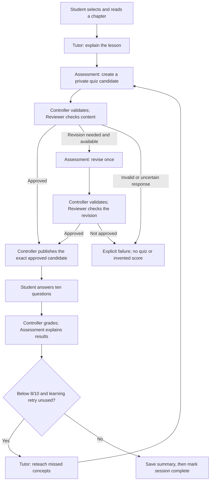

# Study Buddy

Study Buddy helps beginner students read a biology lesson, get an AI explanation, answer a 10-question quiz, and revisit missed concepts through feedback and one focused retry.

Built by **Ivaylo Nanev and Soma Majumder**. Updated **October 29, 2026**, following the workbook and journey fixes merged in [PR #60](https://github.com/Soma-Majumder/Study-Buddy/pull/60).

## Current status

| Area | What is available |
| --- | --- |
| Student workbook | Landing page, biology chapter selection, original-source reading, AI preparation progress, Tutor explanation, answer selection and confirmation, grading, feedback, one retry, and a saved summary. |
| Agents | Tutor teaches and reteaches; Assessment generates/revises quizzes and explains results; Reviewer checks candidate quality. The controller handles routing, validation, grading, budgets, publication and persistence. |
| Reliability | Owned reads, private answer keys, duplicate-start/submission handling, separate repair and learning-retry budgets, operation deadlines, expiry cleanup, migrations and summary-save recovery. The workbook runs expiry maintenance at startup and periodically. |
| Offline verification | The browser journey completed through grading, reteaching, one retry and the saved summary using fixture agents. Automated HTTP and regression checks passed; details below. |
| Live limitation | Real Claude adapters are connected, but fresh quizzes can still be rejected or return invalid Reviewer responses. Reliable live completion across all four chapters is **not yet established**. Failed candidates are not published. |
| Deployment scope | Local assignment application. The workbook uses one trusted local learner profile, not public student authentication or production hosting. A separate gateway-facing HTTP API is also available. |

Code being merged does not prove AI content quality, student learning gains, or production readiness. The remaining live-generation limitation is not resolved by passing fixture tests.

## Student journey

1. Open the landing page and choose **Start learning**.
2. Select a biology chapter. Read the original textbook chapter on the publisher's site; an optional local adapted excerpt is labeled separately.
3. Deliberately start AI preparation. Tutor's saved explanation becomes readable while the quiz is generated and reviewed.
4. Answer ten questions and confirm submission. The controller grades against the private saved answer key; Assessment explains the results.
5. At **8/10 or higher**, continue to the summary. Below 8/10, Tutor reteaches the missed concepts and the student gets **one focused 10-question retry**.
6. After that retry, save the final summary regardless of score. The session is complete only after the summary is saved.

Opening the site without an explicit route shows the landing page. Existing server sessions remain available separately; opening a new session does not delete them.

### Biology chapters

| Chapter | Lesson version |
| --- | --- |
| Membrane Structure & Composition | 2 |
| Cell Theory & Cell Types | 1 |
| Passive Transport & Diffusion | 1 |
| Active Transport & Cellular Pumps | 1 |

The live workbook loads all four approved catalog entries. Offline fixture practice is limited to **Membrane Structure & Composition**; it does not simulate the other three chapters. Catalog approval is an application flag, not a claim of independent human content review. Local lesson files are adapted teaching selections, not full textbook imports.

## How the agents work together



Tutor hands off its explanation and taught concepts with lesson/session identity. Assessment produces a private candidate with an answer key. Reviewer returns findings bound to that candidate; the controller decides whether to publish it. After grading, weak-concept feedback provides the scope for Tutor's reteaching. Technical failures are never counted as wrong student answers.

The Reviewer is a separate quality-checking agent in the current implementation. It does not grade students, route the workflow, or independently authorize publication. See the [quiz quality-gate design](docs/quiz-quality-gate-design.md) for its bounded review/revision policy.

## Set up locally

Use Python 3.12+, Node.js 22+ and pnpm. From the repository root:

```sh
python3 -m venv .venv
source .venv/bin/activate
python -m pip install -r requirements-dev.txt
pnpm --dir backend install --frozen-lockfile
```

See [LOCAL_CHECKS.md](LOCAL_CHECKS.md) for dependency and platform details. Keep `.env`, local databases and private evaluation logs out of Git. Never put real credentials in examples or commit them.

### Run without paid calls

```sh
python3 -B scripts/student_workbook.py --agents offline --port 8778
```

Open [the landing page](http://127.0.0.1:8778/student/#library). This mode uses the real controller and SQLite persistence with fixture agent content and synthetic review. It requires no Claude key. Retry questions may repeat; this verifies the application workflow, not live AI question quality.

For an isolated review database, add `--database /tmp/study-buddy-review.sqlite`.

### Run with real Claude agents

```sh
python3 -B scripts/student_workbook.py --port 8778 --agents live \
  --allow-paid-calls --env-file /absolute/path/to/your/.env
```

The trusted environment file supplies `ANTHROPIC_API_KEY` and optional `ANTHROPIC_MODEL`. Existing nonempty process settings take precedence. Set `STUDY_BUDDY_NODE` to the Node executable if it is not on `PATH`.

**Paid calls occur when you deliberately prepare a lesson, request feedback, or prepare a retry.** Page loads, original chapter reading, progress reads and reconnecting do not dispatch AI. An API request cannot enable paid calls. Live mode uses the existing adapters with no fixture fallback.

Offline and live modes use separate ignored databases (`.student-local/workbook.sqlite` and `.student-local/workbook-live.sqlite`), learner profiles and browser drafts. Answer keys stay server-side until the corresponding attempt is submitted. Loopback Host, Origin and action-token checks protect the local HTTP boundary; they are not public account authentication.

**After pulling Python/backend changes, stop and restart the workbook server.** Refreshing Safari alone reloads frontend assets and can leave the old backend running. Avoid interrupting an active paid operation; a call interrupted by shutdown cannot be assumed to resume. Expired operations are reconciled without another AI call, and saved explanations remain available.

For the separate gateway-facing service, see [Local HTTP API and tunnel](docs/local-api-and-tunnel.md). Its setup, registered learners and bearer authentication are distinct from the local student workbook. Starting the workbook does not start that API or a public tunnel. To show the live workbook on the Vercel site from your own computer, see [Public demo through a Cloudflare Tunnel](docs/public-demo-tunnel.md).

## Hosted assignment demo

To run without a laptop or temporary tunnel, use the [Render backend deployment guide](docs/hosted-demo.md). The root Dockerfile and `render.yaml` configure Python + Node, a protected public listener, and persistent SQLite storage. Hosting requires account setup and plan approval; these files alone do not deploy a running service.

## Checks and evidence

These checks require no paid model calls:

```sh
# Full Python/backend suites
python3 -B -m unittest discover -q
pnpm --dir backend test

# Focused workbook checks
python3 -B scripts/check_workbook_inprocess.py
python3 -B -m unittest tests.test_student_workbook
node --test tests/student-journey.test.cjs tests/student-start-routing.test.cjs

# Offline pass, retry and blocked-quiz scenarios
python3 -B scripts/check_backend_offline.py
```

The October 29 workbook audit recorded:

- **23 real HTTP tests passed** on disposable databases, including pass/retry, duplicate submissions, ownership, summary-save recovery and expiry.
- **23 in-process checks passed** using actual handlers/controller code without sockets.
- **116 JavaScript tests passed** across backend adapters and workbook routing/race regressions.
- **Browser fixture journey completed:** landing → source reading → explanation → ten answers → 3/10 feedback → reteaching → one ten-question retry → saved final summary. No second retry was offered.

Those are scoped results, not a claim that the full current Python discovery suite or a fresh paid end-to-end session was run during this audit. No paid calls were made for the audit or publication. Live generation/Reviewer reliability remains an open limitation. See [workbook review instructions](docs/student-workbook-review.md) and the [verification record](demo/student/verification.json).

## Working together

| Area | Ivaylo leads | Soma leads |
| --- | --- | --- |
| Tutor | Teaching/reteaching implementation | Teaching-quality review |
| Assessment | Controller integration of the agreed interface | Quiz generation, revision and feedback behavior |
| Reviewer | Dispatch, deadlines, saved reports and publication integration | Prompt, quality rubric and benchmarks |
| Controller and storage | Routing, grading, ownership, persistence, migrations, duplicate handling and recovery | Integration review and reporting behavior gaps |
| Tests and documentation | Controller/reliability checks and current implementation status | Agent-quality evaluations and product-behavior review |

Choose one implementation owner per task and agree on affected files before starting. Coordinate changes to handoff contracts, lesson content, shared provider transport, database/migration schemas, PRD requirements and public interfaces. Check the current target branch on GitHub; use the agreed integration branch and batch related work into a reviewable PR. Have the partner review before merging. This workbook update targeted `main`; older documentation mentioning `dev` was not an instruction to ignore the current PR base.

Do not expand the agent count, rewrite a partner's component, or add product scope merely to solve an integration problem. Assign ownership for new frontend or deployment work explicitly.

## Product documentation

- [Google PRD — product source of truth](https://docs.google.com/document/d/1MuA6lEJigDXQGIhVv3FKvgnLPPqIrBOd5FBY1T0qZXY/edit?tab=t.6wuguzynoy44)
- [Repository PRD PDF — dated export](docs/Study-Buddy-PRD.pdf)
- [Backend operation and maintenance](backend/README.md)
- [Workbook review and remaining limits](docs/student-workbook-review.md)
- [Quiz review architecture and policy](docs/quiz-quality-gate-design.md)
- [Record conventions](docs/ids-and-records.md)
- [Backend audit closeout](docs/evals/backend-audit-closeout-2026-10-28.html)
- [Historical development notes](docs/archive/backend-development-notes-2026-10-26.md)

PRD, PDF and README synchronization is manual. This README update does not update the Google document or regenerate the PDF. The PRD's **60% retry-improvement target** is a proposed pilot metric, not the **8/10 pass threshold** or an observed learning result. Returning-learner recommendations, spaced practice, public student authentication, deployment supervision and a student pilot remain outside the verified local journey.

## Educational source

The biology lessons are adapted from *Cell & Molecular Biology* by Marg Sonnenfeld and Jonathan (Jung Lynn) Jung, Thompson Rivers University. Each lesson file includes its source URL, attribution, license and adaptation notice. The original membrane chapter is [section 2.1](https://cellandmolecularbiology.pressbooks.tru.ca/chapter/2-1/).

Content uses [CC BY-NC-SA 4.0](https://creativecommons.org/licenses/by-nc-sa/4.0/). Preserve attribution, adaptation notices and applicable non-commercial ShareAlike conditions. No source figures are included. Review source permissions and teaching content before adding lessons.
