<div align="center">

# 📚🧠 Study Buddy

### *A friendly AI team that teaches you biology, quizzes you, and helps you fix what you missed.*

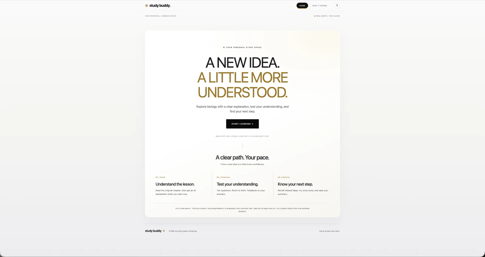

</div>

---

## 😩 The Problem

Picture a student opening a biology textbook for the first time.

- 📖 The chapter is **long and full of new words** like "phospholipid bilayer".
- 🤷 They read it all... and **have no idea if they actually understood it**.
- ❓ Online quizzes are usually **generic**, and they only say "wrong" without explaining **why**.
- 😵 So the student guesses, gets discouraged, and moves on without fixing the gap.

**Reading is not the same as learning.** Students need someone to *explain it simply*, *test them fairly*, and *go back over the parts they missed*. Most beginners don't have a tutor sitting next to them to do that.

## 💡 Our Idea

**Study Buddy is that tutor.** It takes one real biology chapter and walks a student through a simple loop:

> 📖 **Read** → 🧑‍🏫 **Get it explained** → ✍️ **Take a 10-question quiz** → 💬 **See what you missed** → 🔁 **Try one more time**

Everything is kept short, kind, and focused on **understanding**, not just memorizing.

## 🎯 Who Is This For?

| 🙋 Who | 💖 How Study Buddy helps |
| --- | --- |
| **Beginner students** learning biology | Explains tricky ideas in plain language, step by step |
| **Students who feel lost or unsure** | Shows exactly *which* ideas they missed, not just a score |
| **Anyone who wants a second chance** | Gives one focused retry on the weak spots |
| **Teachers and reviewers** | Every quiz is checked before a student ever sees it |

---

## 🤖 Meet the 3-Agent Team

Instead of one AI trying to do everything, Study Buddy uses **three specialist AI helpers** (we call them *agents*). Each has one job, just like a real school team.

| | Agent | 🎭 Their job | 🗣️ In plain words |
| --- | --- | --- | --- |
| 🧑‍🏫 | **Tutor** | Teaches the lesson, and re-teaches missed ideas later | *"Let me explain that in a simpler way."* |
| 📝 | **Assessment** | Writes the quiz, explains the results | *"Here are 10 questions, and here's why you missed #4."* |
| 🕵️ | **Reviewer** | Double-checks every quiz **before** the student sees it | *"Hold on. This question is confusing, so let's fix it."* |

There's also a quiet **fourth member, the Controller**. It's not an AI. It's plain, reliable code that acts like the **school principal**: it decides who goes next, grades the answers, keeps the answer key secret, and saves everyone's progress. 🗝️

### 🔄 How they work together

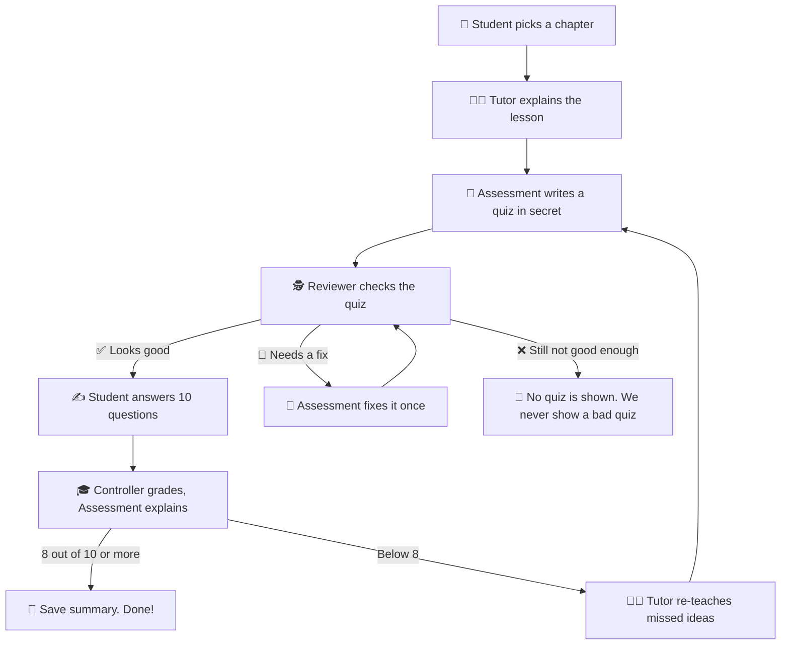

*👀 What the student sees while the team works behind the scenes: the Tutor writes the summary, then the quiz is written and reviewed.*

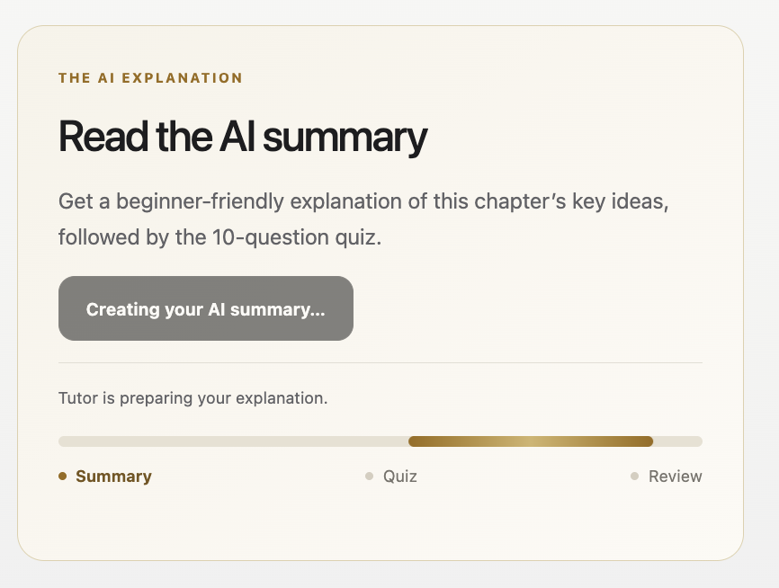

### 🛡️ Safety rules we built in

- 🔒 **The answer key stays private** until the student has submitted their answers.
- 🚫 **A quiz that fails review is never shown.** We'd rather show nothing than a bad question.
- 🤝 **A technical hiccup is never counted as a wrong answer.** If something breaks, it's our fault, not the student's.
- 🔁 **Only one retry**, and it focuses on the ideas the student actually missed.
- 💾 **Progress is saved**, so closing the browser doesn't lose your place.

---

## 🧬 Where Did the Information Come From?

All lessons are based on a **free, open textbook**:

> 📘 ***Cell & Molecular Biology*** by **Marg Sonnenfeld** and **Jonathan (Jung Lynn) Jung**, Thompson Rivers University.
> Read the original: [cellandmolecularbiology.pressbooks.tru.ca](https://cellandmolecularbiology.pressbooks.tru.ca/chapter/2-1/)

We shortened and simplified selected sections into **four beginner chapters**:

| # | 🧫 Chapter |
| --- | --- |
| 1 | **Membrane Structure & Composition** |
| 2 | **Cell Theory & Cell Types** |
| 3 | **Passive Transport & Diffusion** |
| 4 | **Active Transport & Cellular Pumps** |

📜 The textbook is shared under a [Creative Commons license (CC BY-NC-SA 4.0)](https://creativecommons.org/licenses/by-nc-sa/4.0/), so we give the authors full credit, mark where we adapted their words, and keep our use non-commercial. Students are also pointed back to the **original chapter** on the publisher's site. We include no figures from the book.

---

## 🎬 A Student's Journey

1. 🏠 **Open the app** and press **Start learning**.
2. 🧫 **Pick a biology chapter.** You can read the original textbook chapter right from here.
3. 🤖 **Tell Study Buddy to get ready.** The Tutor's explanation appears while the quiz is being written and checked in the background.
4. ✍️ **Answer 10 questions**, then confirm.
5. 💬 **See your results.** Every missed idea gets a friendly explanation.
6. 🎉 **Scored 8/10 or higher?** Awesome, save your summary!
7. 🔁 **Scored below 8?** No stress. The Tutor re-teaches what you missed, and you get **one focused retry**.
8. 💾 **Save your final summary.** The session is finished once it's saved.

| 📚 1. Choose a chapter | 🔀 2. Choose how to read | 🧑‍🏫 3. Read the Tutor's explanation |
| :---: | :---: | :---: |
| 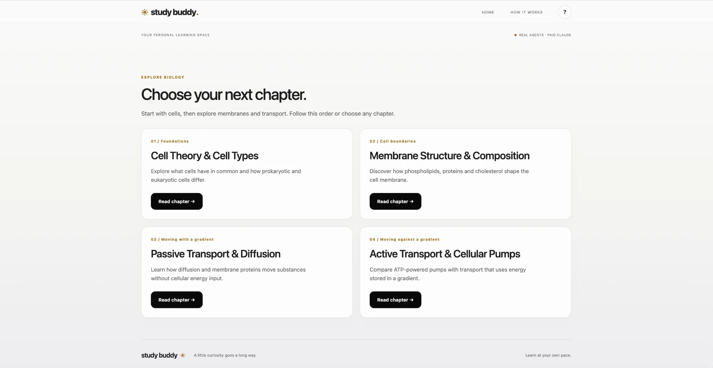 | 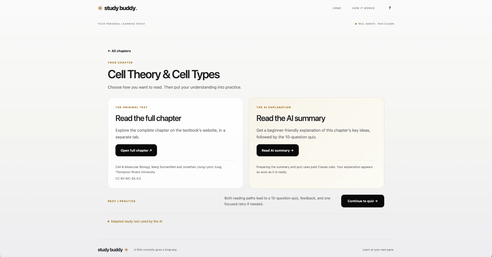 | 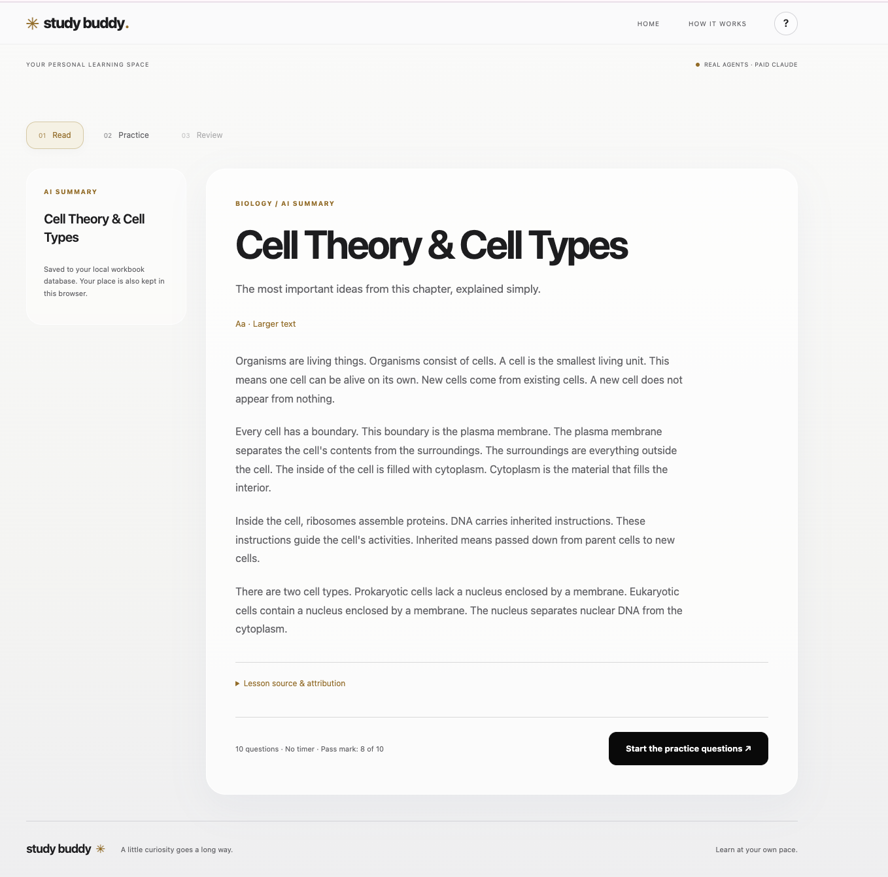 |

| ✍️ 4. Take the quiz | 💬 5. Get feedback | ⏳ 6. Tutor prepares re-teaching |
| :---: | :---: | :---: |
| 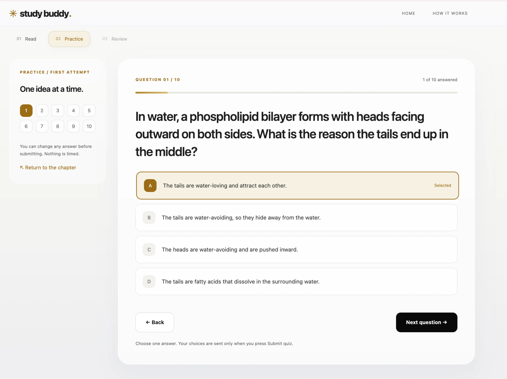 | 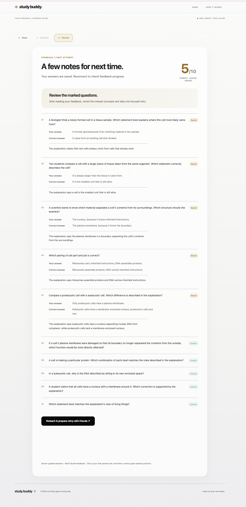 | 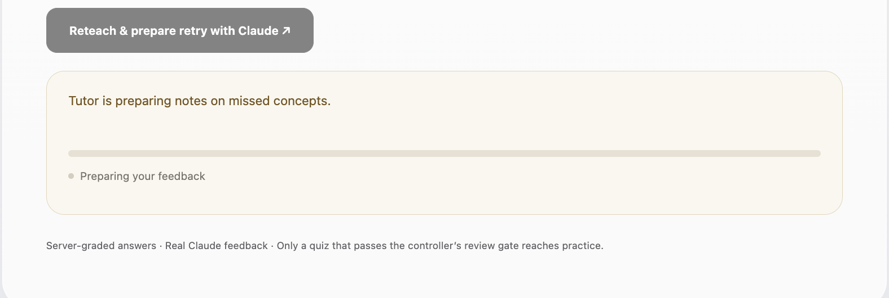 |

| 🔍 7. Look at missed ideas again | 🔁 8. One focused retry | 🏁 9. Final summary |
| :---: | :---: | :---: |
| 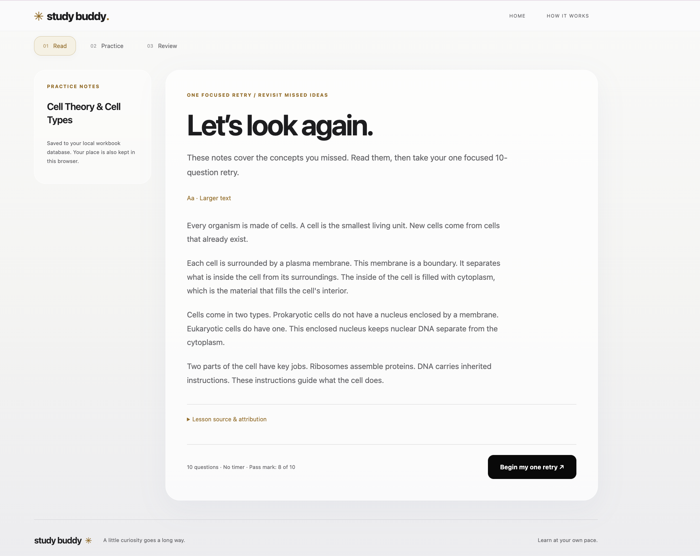 | 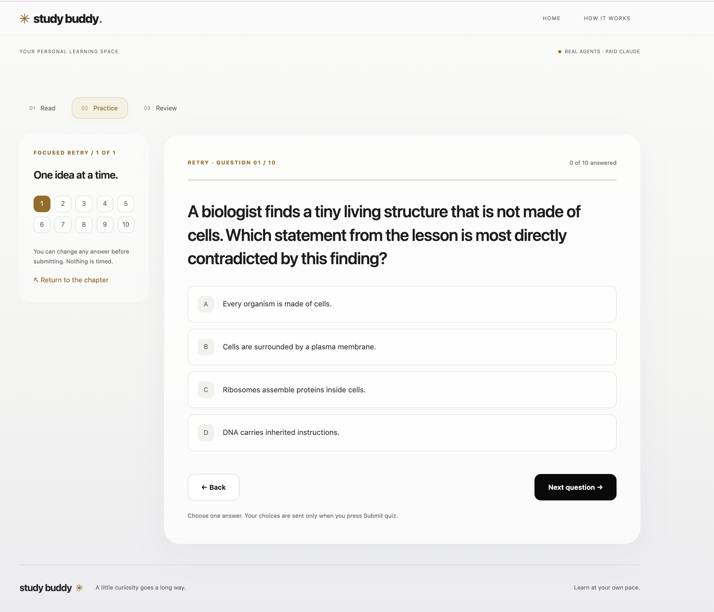 | 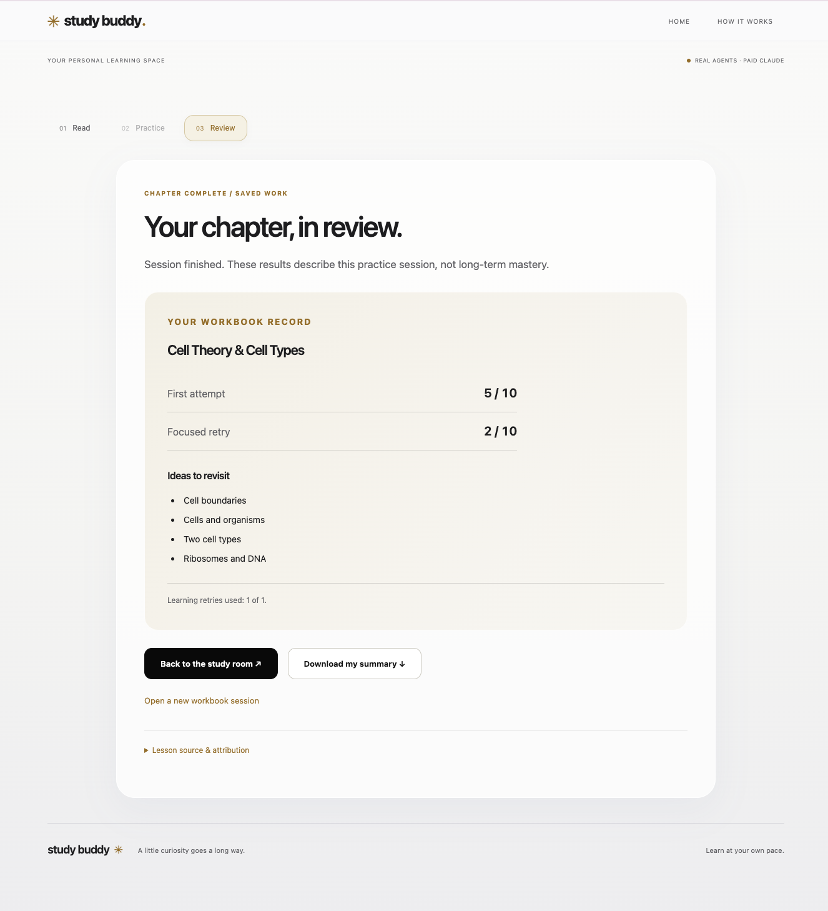 |

---

## ✅ What Works Today (and What Doesn't Yet)

We want to be honest about where we are. 🙌

**🟢 Working**

- The full student journey, from landing page to saved summary.
- Offline practice mode, which needs **no AI account or cost**. It uses sample content so anyone can try the whole flow.
- Safe handling of tricky moments: double-clicks, refreshing the page, a slow AI, or a half-finished session.
- Automated checks: **23 real web-request tests, 23 in-process checks, and 116 JavaScript tests** passed in our October 29 audit.

**🟡 Still a work in progress**

- With the **real Claude AI**, a fresh quiz is sometimes rejected by the Reviewer or comes back in a shape we can't use. When that happens, we show nothing rather than a bad quiz. **Smooth live results across all four chapters aren't proven yet.**
- This is a **local school-project app**. It has one trusted local learner, not student logins or public hosting.
- Passing tests doesn't prove students *learn better*. That would need a real pilot with real students.

---

## 🙌 Who Did What

Two builders, one team. 💪 Say hello first! 👋

<table>
  <tr>
    <td align="center" width="50%" valign="top">
      
      <h3>Soma Majumder</h3>
      <p>🎊 Drop by and say hello! Always happy to chat!</p>
      <p>
        <a href="https://github.com/Soma-Majumder">🐙 GitHub</a> &nbsp;|&nbsp;
        <a href="https://www.linkedin.com/in/somamajumder/">💼 LinkedIn</a>
      </p>
    </td>
    <td align="center" width="50%" valign="top">
      
      <h3>Dr. Ivaylo Nanev</h3>
      <p>🎊 Drop by and say hello! Always happy to chat!</p>
      <p>
        <a href="https://github.com/IvayloNanev">🐙 GitHub</a> &nbsp;|&nbsp;
        <a href="https://www.linkedin.com/in/dr-ivaylo-nanev-67620688/">💼 LinkedIn</a>
      </p>
    </td>
  </tr>
</table>

Here's how the work was shared, based on our project history.

### 🧑‍💻 Ivaylo Nanev, *the Engine Builder* ⚙️

Ivaylo built most of the machinery that keeps everything running smoothly and safely.

- 🧑‍🏫 **Built the Tutor**: the teaching and re-teaching agent, including its safety checks.
- 🕵️ **Built the Reviewer**: the quiz-checking agent, plus the "check, fix once, check again" quality rule.
- 🎛️ **Built the Controller**: the "principal" that starts sessions, routes work between agents, grades answers, runs the retry, and saves summaries.
- 💾 **Made it reliable**: protection against double-clicks, lost progress, timeouts, and crashed sessions, plus database upgrades and a cleanup helper for abandoned sessions.
- 🔌 **Connected the real Claude AI** to the Assessment and Reviewer agents, with a rule that **paid AI calls only happen when you deliberately allow them**.
- 🖥️ **Built the student workbook**, the website students use, and fixed its journey, loading screens, and navigation.
- 🧪 **Tested and documented**: offline test scenarios, audits, and the progress write-ups.

### 👩‍💻 Soma Majumder, *the Quiz and Content Builder* 🎨

Soma shaped what students learn, how quizzes are made, and how the team measures quality.

- 🧬 **Created the lessons**: the first Cell Membranes lesson, with concept IDs and manual approval.
- 📐 **Set up the foundations**: the shared ID formats, the database design, and the "handoff" rules agents use to pass work to each other.
- 📝 **Built the Assessment agent**: the quiz-writing prompt, runner, and quiz format checks.
- 🔑 **Built grading and answer keys**: private answer storage, scoring, weak-concept detection, and result explanations.
- 🏅 **Defined "what makes a good quiz"**: a labelled benchmark of good and bad quizzes, and the policy on when a quiz is blocked or only warned about.
- 🏃 **Built the live test runners** that run a whole study session end to end, and traced why the Reviewer rejected quizzes.
- 🌐 **Built the HTTP API**, the secure doorway that lets other apps talk to the Controller.
- 🌍 **Built the public demo**: the sample quiz page, plus the Vercel link that lets people try it online.
- 📄 **Kept the PRD** (the product plan) up to date.

### 🤝 Together

- 📋 Agreed on the product plan and the three-agent design.
- 🔍 Reviewed each other's work before it was merged.
- 🧭 Decided together to keep the agent count at three and not to add extra scope.

---

## 🚀 Try It Yourself

You'll need **Python 3.12+**, **Node.js 22+**, and **pnpm**. From the project folder:

```sh
python3 -m venv .venv
source .venv/bin/activate
python -m pip install -r requirements-dev.txt
pnpm --dir backend install --frozen-lockfile
```

### 🎮 Option 1: Free practice mode (no AI account needed)

```sh
python3 -B scripts/student_workbook.py --agents offline --port 8778
```

Then open **[http://127.0.0.1:8778/student/#library](http://127.0.0.1:8778/student/#library)** in your browser. This uses sample content so you can try the whole flow. The retry quiz may repeat questions. This mode checks that the app works, not that the AI is smart.

### 🤖 Option 2: Real Claude AI (this costs money 💸)

```sh
python3 -B scripts/student_workbook.py --port 8778 --agents live \
  --allow-paid-calls --env-file /absolute/path/to/your/.env
```

Your `.env` file holds your `ANTHROPIC_API_KEY`. **Never share it or commit it to Git.** Paid calls happen only when you deliberately prepare a lesson, ask for feedback, or prepare a retry. Just opening pages costs nothing.

> 🔄 **Tip:** After updating the code, **stop and restart** the server. Refreshing the browser alone can leave old code running.

### 🧪 Run the checks (free)

```sh
python3 -B -m unittest discover -q
pnpm --dir backend test
python3 -B scripts/check_backend_offline.py
```

More details: [LOCAL_CHECKS.md](LOCAL_CHECKS.md), [backend guide](backend/README.md), [local API and tunnel](docs/local-api-and-tunnel.md), [public demo setup](docs/public-demo-tunnel.md).

---

## 📎 Learn More

- 📄 [Product plan (Google PRD)](https://docs.google.com/document/d/1MuA6lEJigDXQGIhVv3FKvgnLPPqIrBOd5FBY1T0qZXY/edit?tab=t.6wuguzynoy44) · [PDF copy](docs/Study-Buddy-PRD.pdf)
- 🔎 [Workbook review and remaining limits](docs/student-workbook-review.md)
- 🕵️ [How quiz review works](docs/quiz-quality-gate-design.md)
- 🧾 [Record conventions](docs/ids-and-records.md)
- 📊 [Backend audit closeout](docs/evals/backend-audit-closeout-2026-10-28.html)
- 🗂️ [Historical development notes](docs/archive/backend-development-notes-2026-10-26.md)

The product plan sets a **60% retry-improvement goal**. That is a target for a future pilot, **not** a result we have measured, and it is separate from the 8/10 pass mark.

---

<div align="center">

Made with 💚 by **Ivaylo Nanev** and **Soma Majumder**

*Helping beginners go from "I read it" to "I get it."* 🌱

</div>
