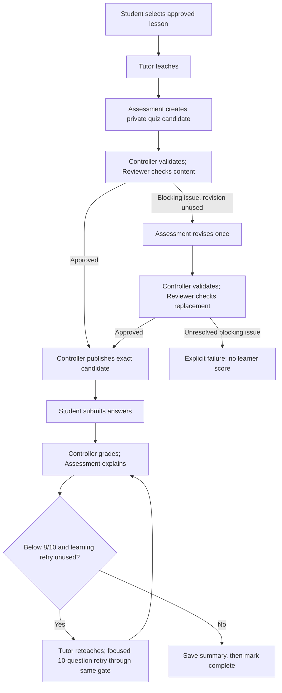

# Study Buddy

Study Buddy helps beginner students learn an approved lesson, answer a 10-question quiz, and revisit missed concepts through feedback and one focused retry.

Owners: Ivaylo Nanev and Soma Majumder. Documentation synchronized October 26, 2026 against merged `dev` commit `8c53b0d`. “Implemented” means merged backend behavior checked offline, not a deployed product or proven learning outcome.

## Delivery status

| Status | Scope |
| --- | --- |
| Implemented in `dev` | Tutor explanations/reteaching; Assessment quiz generation/result explanations; separate Reviewer quality checks and one bounded content revision; exact approved-candidate publication; deterministic grading; one learning retry; durable records and final summary saving; read-only reconnect actions for session status, current quiz and saved summary ([PR #47](https://github.com/Soma-Majumder/Study-Buddy/pull/47)) and opt-in session-start reservations ([PR #48](https://github.com/Soma-Majumder/Study-Buddy/pull/48)). |
| Implemented reliability | Ownership checks; identical-submission replay and changed-answer rejection; explicit paid-call opt-in; crash expiry and repeating maintenance worker with bounded lock retries; migration tracking, baseline adoption, backups and atomic execution. `session_flow.resume_summary` retries a pending summary save from an existing session ID. PRs [#39](https://github.com/Soma-Majumder/Study-Buddy/pull/39), [#40](https://github.com/Soma-Majumder/Study-Buddy/pull/40), [#43](https://github.com/Soma-Majumder/Study-Buddy/pull/43), and [#45](https://github.com/Soma-Majumder/Study-Buddy/pull/45) are merged. |
| Under review | [PR #49](https://github.com/Soma-Majumder/Study-Buddy/pull/49): feedback/reteaching deadlines (migration 010), expiry sweeps for abandoned work, next-action guidance and an offline controller lab. |
| Local prototype, not merged | `codex/lesson-picker`: terminal lesson picker, saved hand-written explanation/quiz, answer collection and deterministic feedback. No live model calls or saved progress. These demo commands are not available on `dev` yet. |
| Planned / not yet verified | Student web UI/authentication; four more lessons for the five-lesson pilot; returning-learner history/recommendations; P1 confidence, misconception evidence, spaced review and source-linked progress; deployment/supervision; independent live Reviewer validation and student pilot. |

Only one approved lesson currently ships: **Membrane Structure & Composition, version 2**. Product requirements describe the intended experience; P0/P1/P2 are priorities, not completion labels.

## Workflow and ownership



Tutor owns teaching/reteaching. Assessment owns quiz generation, content revision and explanations of controller-verified results. Reviewer is a separate isolated task; it returns findings, not permission to write data. The controller owns routing, approval, deterministic grades, weak-concept counts, budgets and persistence. Ivaylo leads controller/reliability work; Soma leads Assessment behavior, rubric and benchmarks. Shared contracts are reviewed together.

Core rules: 10 questions per round; pass at **8/10**; one student learning retry; technical failures never count as wrong answers. The **60%** retry-improvement target in the PRD is a proposed pilot metric, not the pass threshold or an observed result.

## Partner work division — proposed for Soma’s review

Use this division to choose work without overlapping. Component ownership identifies who leads implementation; both partners review shared behavior. This proposal is awaiting Soma’s review in [PR #46](https://github.com/Soma-Majumder/Study-Buddy/pull/46).

| Area | Ivaylo leads | Soma leads |
| --- | --- | --- |
| Tutor (Agent 1) | Explanation and targeted reteaching implementation | Teaching-quality review |
| Assessment (Agent 2) | Controller integration of the agreed interface | Quiz generation, content revision and result-feedback behavior |
| Reviewer | Dispatch, timeouts, saved reports and exact-candidate publication | Reviewer prompt, quality rubric and evaluation benchmarks |
| Controller | Routing, deterministic grading, duplicate submissions, retry limits and summary recovery | Integration review and reporting behavior gaps |
| Database and operations | Persistence, migrations, crash cleanup and maintenance worker | Communicate storage requirements before shared schema changes |
| Tests | Controller, persistence, concurrency and recovery checks | Agent behavior and content-quality evaluations |
| Documentation | Current implementation status, README maintenance and PRD exports | Product-behavior and Assessment-description review |

### Shared changes: agree before editing

Handoff schemas, database schema/migration contracts, shared Claude transport, approved lesson content, PRD requirements and public function signatures need coordination before either partner edits them. Agree on inputs, outputs and affected files first, and name one implementation owner for the shared change. A component owner may request an interface change; that does not transfer ownership of the partner’s agent behavior.

### Working rules

1. One issue, one implementation owner and one branch from current `dev`. List the expected files in the issue or PR before starting.
2. Edit your component. Agree on cross-component interfaces before changing the other partner’s code; communicate when the file list or scope expands.
3. Use fixtures while waiting for integration. Connecting Assessment is not a reason to rewrite its prompt, quiz quality policy or feedback behavior.
4. Keep PRs focused and have the partner review before merging. Record integration needs and follow-ups rather than silently expanding scope.
5. Assign new areas before starting them. Frontend ownership is currently unassigned; agree on an owner and interface before either partner begins.

Current direction: Ivaylo continues controller recovery/integration; Soma reviews open PRs and leads Assessment/Reviewer content-quality work. Pause expansion of the local terminal demo until its purpose and owner are agreed. The assistant helping either partner should check this division before proposing implementation and flag shared-file changes before editing them.

## Run offline checks

Use Python 3.12+ and Node.js 22+ with pnpm. From the repository root:

```sh
python3 -m venv .venv
source .venv/bin/activate
python -m pip install -r requirements-dev.txt
pnpm --dir backend install --frozen-lockfile
python -B -m unittest discover -q
pnpm --dir backend test
```

Offline tests use fixture agents or fake transports. They check contracts, ownership, routing and persistence; they do not establish semantic quiz quality or student learning gains. No live evaluation is required for these commands.

## Configuration and paid calls

Keep credentials in a local ignored `.env`; never commit it. Use placeholder values when documenting configuration; required variable names are listed in the backend guide. Python callers and the live Python evaluation runner need variables supplied to their process environment; do not assume every entry point loads `.env` automatically. An API key alone does not authorize paid calls: the transport also requires explicit opt-in. See the [backend guide](backend/README.md#configuration-and-live-evaluations) before deliberately running paid evaluations.

## Documentation and synchronization

- [Google PRD — product source of truth](https://docs.google.com/document/d/1MuA6lEJigDXQGIhVv3FKvgnLPPqIrBOd5FBY1T0qZXY/edit?tab=t.6wuguzynoy44)
- [Repository PRD PDF — dated export of that document](docs/Study-Buddy-PRD.pdf)
- [Backend operation and maintenance](backend/README.md)
- [Quiz review architecture and policy](docs/quiz-quality-gate-design.md)
- [ID and record conventions](docs/ids-and-records.md)
- [Historical backend development notes](docs/archive/backend-development-notes-2026-10-26.md)

Synchronization is manual. On a scope change or PR merge, update the Google PRD's delivery status, export a fresh PDF, and update both READMEs in the same documentation change. Keep merged behavior distinct from open PRs and local prototypes. Review Google Docs concurrently with the Git changes: committing the PDF does not publish or merge repository changes automatically.

## Educational source

The current lesson is adapted from *Cell & Molecular Biology*, section 2.1, by Marg Sonnenfeld and Jonathan (Jung Lynn) Jung, Thompson Rivers University: https://cellandmolecularbiology.pressbooks.tru.ca/chapter/2-1/. Content is adapted under [CC BY-NC-SA 4.0](https://creativecommons.org/licenses/by-nc-sa/4.0/); preserve source attribution, the lesson's adaptation notice and applicable license conditions. No source figures are included. Future sources, including OpenStax, require per-lesson review before approval.


## Backend audit closeout — October 28

The backend review adds durable Tutor repair authorization, offline checks, and four focused factual safeguards/corrections. Read the [audit closeout](docs/evals/backend-audit-closeout-2026-10-28.html) and [local check instructions](LOCAL_CHECKS.md) for validation and remaining limits. The manual corrected retry candidate is not Reviewer-approved or published; no new live-generation success is claimed.


## Local student workbook

From an environment with the existing Python backend dependencies installed, run `python3 -B scripts/student_workbook.py --port 8778`, then open `http://127.0.0.1:8778/student/`. The workbook calls the existing controller, grades on the server, and saves local progress to ignored `.student-local/workbook.sqlite`. It uses one trusted local profile and offline fixture agents only: no API key, live provider calls, or paid opt-in. Fixture reviews are synthetic, and focused retry questions may repeat. This is a local assignment demonstration, not an authenticated deployment.

The server serves an explicit asset allowlist and omits unanswered keys. It reuses learner ownership, start request IDs, reviewed-publication retrieval, duplicate submission handling, one retry and final summary persistence. The UI keeps only the current pointer and draft in browser storage; opening a new session preserves old server records. HTTP protections check the loopback Host, Origin and an action token. They are not account authentication.

Run `python3 -B -m unittest tests.test_student_workbook -q` for the sixteen HTTP/controller and live-wiring tests. See `demo/student/verification.json` for offline and browser verification evidence. The frontend branch builds on the backend closeout commit in PR #56; that PR is unchanged.


### Real-agent workbook mode

To use the existing Claude adapters, start the local server with `python3 -B scripts/student_workbook.py --port 8778 --agents live --allow-paid-calls --env-file /absolute/path/to/your/.env`. Set `STUDY_BUDDY_NODE` to the Node executable if it is not on PATH, and install the existing locked backend dependencies. `--allow-paid-calls` is a trusted server opt-in; an API request cannot enable it. The explicit environment file supplies only `ANTHROPIC_API_KEY` and optional `ANTHROPIC_MODEL`, never shell commands or paid consent, and its contents are never served. Existing nonempty process settings take precedence.

Live mode uses a separate ignored `workbook-live.sqlite` database/profile and a separate browser draft. The reading page renders the actual saved Tutor explanation. Opening/refreshing the page and retrieving progress do not dispatch agents. Starting a chapter invokes Tutor → Assessment → Reviewer through the existing controller, including the existing bounded revision when needed. Submission grades on the server and requests Assessment feedback. A deliberate low-score continuation invokes Tutor reteaching and the one reviewed retry; completion saves the summary. There is no fixture fallback if a live operation fails.

The live mode was wired and verified offline: 575 Python tests, 98 JavaScript tests and 3/3 scenario groups passed. Sixteen workbook tests include stubbed live-mode routing, real-adapter identity checks and paid-call guards. The earlier browser completion was fixture-based. No new paid session was started by the assistant; live mode is ready for the user’s explicit workbook actions.
