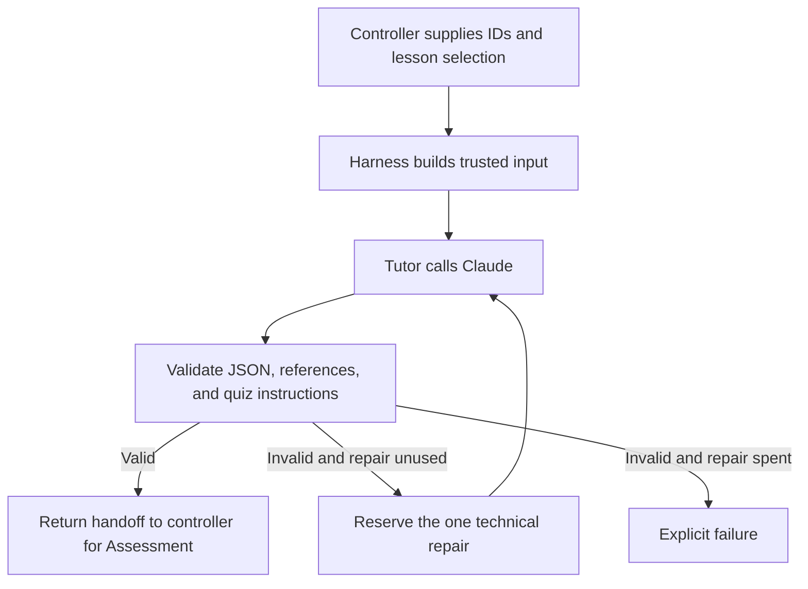

# Study Buddy Tutor (Agent 1)

The Tutor turns an approved lesson into a beginner-friendly explanation, or reteaches verified missed concepts. This module returns a validated handoff; the controller decides what happens next.

## Where this fits



## Parts to learn

| Part | Code | Responsibility |
| --- | --- | --- |
| Harness input | `tutor-input.mjs`, `lessons.mjs` | Load approved content, supply controller IDs, and separate instructions from lesson/feedback data. |
| Prompt | `prompts/tutor-system.md` | Explain or reteach using supplied source text and concept summaries. |
| Provider call | `claude.mjs` | Make one bounded request; reject transport failures and incomplete responses. |
| Agent loop | `tutor.mjs` | Generate, validate, and allow at most one technical repair. |
| Stopping conditions | `tutor.mjs`, `reteaching.mjs` | Reject invalid input before generation; stop on provider failure or exhausted repair; block ineligible reteaching. |
| Handoff checks | `tutor-output.mjs`, `handoff-policy.mjs` | Validate the schema, IDs, sources, concepts, retry focus, and unchanged 10-question/private-answer-key instructions. |
| Tests and evaluation | `*.test.mjs`, `evals/` | Offline regression tests plus separately invoked paid smoke evaluations and human review. |

## Calling the harness

Call `runTutor(context, claudeOptions, repairState)` from `tutor.mjs`. The controller supplies the lesson ID, session ID, handoff ID, and explanation ID. Retry input also requires a verified Assessment return handoff, the trusted current attempt, and the learning retry count.

Success returns `{handoff, model, usage, repairCount}`. `usage` adds reported top-level token counters across completed original and repair responses, including cache counters when supplied. It remains outside the handoff. A `TutorRunError` exposes the failing stage, repair count, and token usage accumulated before failure; unavailable provider usage cannot be estimated.

Technical repair and learning retry are separate. The repair state is consumed before the repair request, even if that request fails. There are at most two model calls in one run. Reteaching is eligible only after a first-round score below 8/10 with an unused learning retry and complete verified weak concepts.

## Run locally

From the repository root, using Node 22+:

```sh
pnpm --dir backend install
pnpm --dir backend test
node backend/evals/run.mjs
```

Offline tests use fake provider responses and do not need an API key. For an explicitly requested paid smoke evaluation, set `ANTHROPIC_API_KEY` in the ignored root `.env`, then run:

```sh
node --env-file=.env backend/evals/run.mjs --live
```

Never commit `.env` or API keys. See `evals/README.md` for scoring and limitations. Existing live results describe the prompt and code at their recorded run; they do not verify subsequent changes.

## Boundaries still belonging to the controller

This module does not grade quizzes, display screens, save sessions, reserve learning retries durably, or coordinate concurrent requests. The controller must persist and reserve repair/retry state to enforce limits across restarts and concurrent runs. Missing weak concepts are rejected here; their repair workflow belongs to the controller.

Structural validation cannot establish factual accuracy or detect every instruction hidden in otherwise valid explanation prose. Human review checks grounding and teaching quality. The handoff fixes instructions for Assessment, but Assessment must separately enforce its actual quiz size and keep its answer key private.

## Offline Tutor-to-Assessment integration test

From the repository root, install the Python validation dependency in a virtual environment and run the cross-language test:

```sh
python3 -m venv /tmp/study-buddy-tests
/tmp/study-buddy-tests/bin/python -m pip install -r requirements-dev.txt
/tmp/study-buddy-tests/bin/python -B -m unittest tests.test_tutor_assessment_integration -v
```

Node 22+ must be on PATH (or set `STUDY_BUDDY_NODE` to its executable); backend dependencies must already be installed. The test runs the real JavaScript Tutor harness with a fake Claude response, passes a fixture quiz with matching IDs through the Python Assessment validator, and saves it to an in-memory database. It checks ten learner-facing questions, private keys, foreign-key integrity, and rejection of stale IDs, wrong rounds, wrong quiz size, and untaught concepts. The return-handoff tests use the real Python grader to compute a 6/10 score and weak concepts, then check that the JavaScript Tutor input builder accepts only those concepts. They also cover the 7/10 and 8/10 boundary, missing weak concepts, and a spent learning retry. The return envelope is assembled by the test as a stand-in for the future controller. These tests make no API calls and do not test AI quiz generation, factual quality, durable retry reservation, or a complete second quiz/session.


## Controller: first routing step

`study_buddy/controller.py` exposes `start_session(conn, learner_id, lesson_id)`. Use a SQLite connection initialized with `db/schema.sql`, load approved lesson files with `study_buddy.lessons.load_lessons`, and register the learner first. The caller must supply the learner ID from trusted application context; authentication is still separate work.

The controller selects the approved lesson version from the database, generates session/handoff/explanation IDs, and commits a teaching session before calling Tutor. `backend/tutor-command.mjs` bridges Python to the existing JavaScript harness using JSON on stdin/stdout. Node must be on PATH or configured by `STUDY_BUDDY_NODE`. A real successful call uses the Claude key in the process environment: load the root `.env` into the backend environment before live use. Never put a key in the input JSON or source code.

The existing Tutor harness owns its one-repair loop. The controller independently checks the returned schema, session IDs, lesson version, sources, and taught concepts before saving the explanation and its concept links in a transaction. It returns `next_step: assessment` on success, but does not dispatch Assessment yet. Session status stays `teaching` because no quiz is ready. It never marks the session completed.

On Tutor/validation failure it records `failed` and returns no handoff or next step. A failed explanation save rolls back its partial records and records failure; if recording failure also fails, the database error propagates instead of claiming success. No score, quiz, or learning retry is created by this step.

Run the seven new offline controller tests from the repository root (Python validation dependencies and backend packages installed, Node available):

```sh
python -B -m unittest tests.test_controller -v
```

Six tests inject a fixture Tutor runner; one exercises the real Node adapter with invalid context that stops before generation. They make no paid API calls. Full successful provider transport is covered separately by the Tutor harness tests/live evaluations. Durable repair reservation while the Node process is running, crash recovery, request idempotency, Assessment routing, and atomic learning-retry reservation remain later controller steps; saving the returned repair count does not enforce limits across a process crash.
