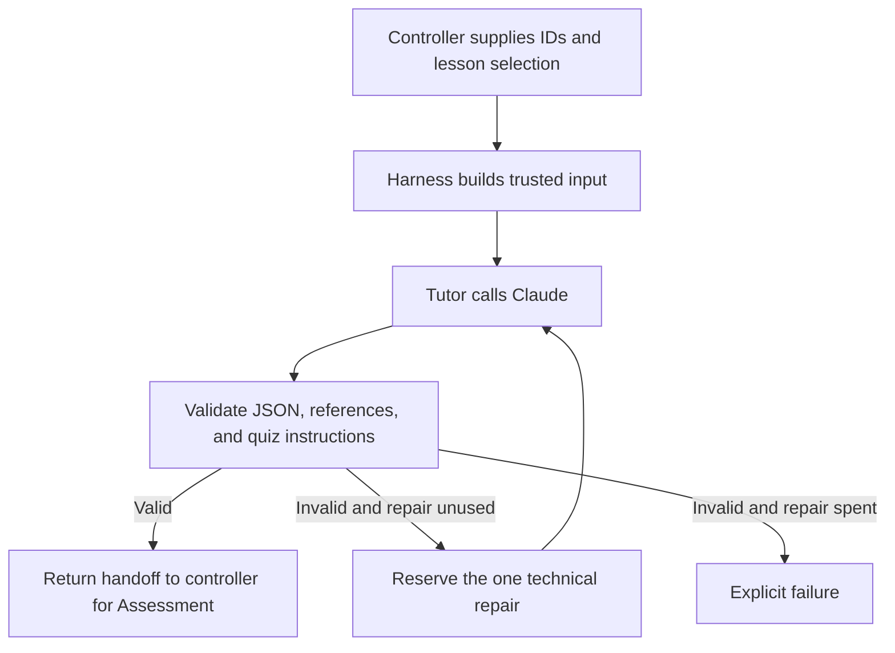

# Study Buddy Tutor (Agent 1)

The Tutor turns an approved lesson into a beginner-friendly explanation, or reteaches verified missed concepts. This module returns a validated handoff; the controller decides what happens next.

## Where this fits



## Parts to learn

| Part | Code | Responsibility |
| --- | --- | --- |
| Harness input | `tutor-input.mjs`, `lessons.mjs` | Load approved content, supply controller IDs, and separate instructions from lesson/feedback data. |
| Prompt | `prompts/tutor-system.md` | Explain or reteach using supplied source text and concept summaries. |
| Provider call | `claude.mjs` | Make one bounded request; reject transport failures and incomplete responses. |
| Agent loop | `tutor.mjs` | Generate, validate, and allow at most one technical repair. |
| Stopping conditions | `tutor.mjs`, `reteaching.mjs` | Reject invalid input before generation; stop on provider failure or exhausted repair; block ineligible reteaching. |
| Handoff checks | `tutor-output.mjs`, `handoff-policy.mjs` | Validate the schema, IDs, sources, concepts, retry focus, and unchanged 10-question/private-answer-key instructions. |
| Tests and evaluation | `*.test.mjs`, `evals/` | Offline regression tests plus separately invoked paid smoke evaluations and human review. |

## Calling the harness

Call `runTutor(context, claudeOptions, repairState)` from `tutor.mjs`. The controller supplies the lesson ID, session ID, handoff ID, and explanation ID. Retry input also requires a verified Assessment return handoff, the trusted current attempt, and the learning retry count.

Success returns `{handoff, model, usage, repairCount}`. `usage` adds reported top-level token counters across completed original and repair responses, including cache counters when supplied. It remains outside the handoff. A `TutorRunError` exposes the failing stage, repair count, and token usage accumulated before failure; unavailable provider usage cannot be estimated.

Technical repair and learning retry are separate. The repair state is consumed before the repair request, even if that request fails. There are at most two model calls in one run. Reteaching is eligible only after a first-round score below 8/10 with an unused learning retry and complete verified weak concepts.

## Run locally

From the repository root, using Node 22+:

```sh
pnpm --dir backend install
pnpm --dir backend test
node backend/evals/run.mjs
```

Offline tests use fake provider responses and do not need an API key. For an explicitly requested paid smoke evaluation, set `ANTHROPIC_API_KEY` in the ignored root `.env`, then run:

```sh
node --env-file=.env backend/evals/run.mjs --live
```

Never commit `.env` or API keys. See `evals/README.md` for scoring and limitations. Existing live results describe the prompt and code at their recorded run; they do not verify subsequent changes.

## Boundaries still belonging to the controller

This module does not grade quizzes, display screens, save sessions, reserve learning retries durably, or coordinate concurrent requests. The controller must persist and reserve repair/retry state to enforce limits across restarts and concurrent runs. Missing weak concepts are rejected here; their repair workflow belongs to the controller.

Structural validation cannot establish factual accuracy or detect every instruction hidden in otherwise valid explanation prose. Human review checks grounding and teaching quality. The handoff fixes instructions for Assessment, but Assessment must separately enforce its actual quiz size and keep its answer key private.

## Offline Tutor-to-Assessment integration test

From the repository root, install the Python validation dependency in a virtual environment and run the cross-language test:

```sh
python3 -m venv /tmp/study-buddy-tests
/tmp/study-buddy-tests/bin/python -m pip install -r requirements-dev.txt
/tmp/study-buddy-tests/bin/python -B -m unittest tests.test_tutor_assessment_integration -v
```

Node 22+ must be on PATH (or set `STUDY_BUDDY_NODE` to its executable); backend dependencies must already be installed. The test runs the real JavaScript Tutor harness with a fake Claude response, passes a fixture quiz with matching IDs through the Python Assessment validator, and saves it to an in-memory database. It checks ten learner-facing questions, private keys, foreign-key integrity, and rejection of stale IDs, wrong rounds, wrong quiz size, and untaught concepts. The return-handoff tests use the real Python grader to compute a 6/10 score and weak concepts, then check that the JavaScript Tutor input builder accepts only those concepts. They also cover the 7/10 and 8/10 boundary, missing weak concepts, and a spent learning retry. The return envelope is assembled by the test as a stand-in for the future controller. These tests make no API calls and do not test AI quiz generation, factual quality, durable retry reservation, or a complete second quiz/session.


## Controller: first routing step

`study_buddy/controller.py` exposes `start_session(conn, learner_id, lesson_id)`. Use a SQLite connection initialized with `db/schema.sql`, load approved lesson files with `study_buddy.lessons.load_lessons`, and register the learner first. The caller must supply the learner ID from trusted application context; authentication is still separate work.

The controller selects the approved lesson version from the database, generates session/handoff/explanation IDs, and commits a teaching session before calling Tutor. `backend/tutor-command.mjs` bridges Python to the existing JavaScript harness using JSON on stdin/stdout. Node must be on PATH or configured by `STUDY_BUDDY_NODE`. A real successful call uses the Claude key in the process environment: load the root `.env` into the backend environment before live use. Never put a key in the input JSON or source code.

The existing Tutor harness owns its one-repair loop. The controller independently checks the returned schema, session IDs, lesson version, sources, and taught concepts before saving the explanation and its concept links in a transaction. It returns `next_step: assessment` on success, but does not dispatch Assessment yet. Session status stays `teaching` because no quiz is ready. It never marks the session completed.

On Tutor/validation failure it records `failed` and returns no handoff or next step. A failed explanation save rolls back its partial records and records failure; if recording failure also fails, the database error propagates instead of claiming success. No score, quiz, or learning retry is created by this step.

Run the seven new offline controller tests from the repository root (Python validation dependencies and backend packages installed, Node available):

```sh
python -B -m unittest tests.test_controller -v
```

Six tests inject a fixture Tutor runner; one exercises the real Node adapter with invalid context that stops before generation. They make no paid API calls. Full successful provider transport is covered separately by the Tutor harness tests/live evaluations. Durable repair reservation while the Node process is running, crash recovery, request idempotency, the live Assessment adapter, and atomic learning-retry reservation remain later controller steps; saving the returned repair count does not enforce limits across a process crash.


## Controller: Assessment boundary and quiz storage

`start_quiz_session(conn, learner_id, lesson_id, assessment=runner)` runs the first Tutor step, then calls `runner(handoff, repair_request=None)` once on the happy path. The runner receives a copy of the validated Tutor handoff and returns the private quiz-output object defined in `schemas/v1/quiz_output.schema.json`. There is no default AI Assessment runner yet; tests inject fixture output.

The controller checks the quiz with Soma's validator: exactly ten questions, matching handoff/explanation IDs and round, taught concepts only, distinct options, and a matching private key. Invalid output can use the remaining technical repair for the same handoff: the count is reserved in SQLite before correction and cannot reset after Tutor already spent it. The runner must make one generation per invocation and must not add its own hidden repair loop. Provider exceptions fail explicitly. The controller does not pass raw invalid model output into the correction instruction.

Saving the quiz, its questions, its separate answer keys, and `awaiting_answers` happens in one transaction. `save_quiz(..., manage_transaction=False)` participates in this caller-owned transaction; existing callers retain its default standalone transaction. Failed saves roll back all quiz records and mark the session failed, while preserving its already saved explanation. A failed failure-status save still propagates rather than claiming success.

Success returns only `{session_id, status, next_step, quiz, error}`; `quiz` comes from `get_client_quiz`, so no answer keys or rationales are sent to the learner. No answer submission, score, or learning retry is created here. The controller suite now has fourteen offline tests, including rejection of mutated input copies and exhausted repair budgets. The real AI Assessment adapter, learner-facing API/authentication, idempotent dispatch, and crash recovery remain separate work.


## Controller: answer submission and deterministic grading

`submit_answers(conn, learner_id, quiz_id, answers)` accepts a complete mapping of stored question IDs to options `a`–`d`. It first checks quiz ownership and that the session is awaiting answers. Missing, extra, or invalid answers raise `SubmissionRejected` and create no attempt or score. A missing/incomplete saved key is a technical failure, never a wrong learner answer.

The controller reads the backend key, calls Soma's deterministic `grade` function, and conditionally claims the session for grading. The claim and all attempt/response/result/weak-concept writes share one SQLite transaction. A savepoint rolls back partial submission records on a save error while retaining the write lock long enough to record the failed session. If that failure record cannot be saved, the database error propagates. A repeated or concurrent submission cannot claim the same awaiting session twice; this currently rejects duplicates rather than returning an idempotent cached response.

After a successful save, the response includes the verified score, pass/fail, per-answer key-based rationales, weak concepts, and stored attempt/result IDs. Correct options appear only after a complete authorized submission has been saved. The stored `results.feedback` is currently JSON containing deterministic graded items, not Assessment-written prose.

The session stays `grading` with `next_step: assessment_feedback`. It does not call an AI feedback agent, reserve a learning retry, or mark completion in this step. Next work is to validate Assessment's feedback against these stored results and route onward. P1 confidence/diagnostic extensions are not implemented here.

Seven additional offline tests cover the 8/10 boundary and weak concepts, bad input, learner isolation, duplicate and simultaneous submissions, missing keys, and transaction rollback. The controller suite now has 21 tests. The concurrent test uses two SQLite connections to a temporary database and verifies exactly one saved attempt and result.


## Controller: validated Assessment result feedback

`explain_results(conn, learner_id, attempt_id, assessment=runner)` is exported from the controller; its implementation lives in `study_buddy/feedback.py`. The callback signature is `runner(context, repair_request=None)` and returns the strict `result_explanation` v1 object. This is an injected adapter boundary; a live AI Assessment feedback runner is not implemented yet.

The controller authorizes the learner/attempt, checks the latest attempt and grading status, and reconstructs verified grading from stored responses and the private key. It checks the stored score and weak-concept evidence for consistency. The callback receives that verified result, the taught explanation, source metadata, IDs, and output schema. It receives a copy so it cannot mutate trusted controller evidence.

A unique `feedback_operations` row claims the attempt before generation and records its `assessment_to_tutor` handoff ID. Repeated calls return running/ready/failed operation state rather than starting a fresh repair budget. Invalid output receives at most one repair, reserved in `handoff_repairs` before the correction call. Provider failure stops explicitly. A running operation after a crash requires reconciliation; it is not automatically restarted.

Validation checks the schema, exact quiz/attempt IDs, ten nonempty feedback entries, unique weak concepts, and the controller's exact missed counts. The controller saves the feedback object in `results.feedback` without changing the verified score, pass/fail, responses, or weak-concept evidence. It also returns the authoritative score/pass separately. Structural checks cannot prove that every prose sentence or summary is factually correct; content evaluation remains necessary.

Success leaves session status `grading` and returns `next_step: retry_decision`. It neither dispatches Tutor reteaching nor marks completion. Feedback/save failure marks the operation and session failed while preserving the saved grading. If the failure record itself cannot be written, the database error propagates.

For a new database, the table is included in `db/schema.sql`. For an existing database created before this step, apply `db/migrations/001_feedback_operations.sql` once before calling feedback routing. The migration is additive; there is no automated migration runner yet.

Run the nine offline feedback tests with:

```sh
python -B -m unittest tests.test_feedback -v
```

They use fixture callbacks and actual saved controller attempts to cover validation, one repair, operation reuse, wrong-learner access, preserved scores, failed writes, and the additive migration. They do not verify live AI content or crash recovery.


## Controller: retry decision and reservation

`decide_next_step(conn, learner_id, attempt_id)` verifies learner ownership, the current attempt, stored grading, and saved/validated Assessment feedback. In one SQLite write transaction it either reserves the first low-score learning retry or records the summary route. `session_routes` persists one decision per attempt and has a unique index allowing only one reteaching route per session.

For a first-round score below 8/10 with retry count 0, it atomically sets count 1 and status `reteaching`, stores a schema-valid Assessment-to-Tutor return handoff, the verified source attempt, and new Tutor handoff/explanation IDs. The prepared context excludes answer keys and reports the actual reserved count of 1. The new outgoing Tutor handoff has its own technical repair record; this does not reset the incoming feedback handoff's repair count. Repeated or simultaneous decisions return the same reservation rather than consuming another retry. Old attempts, failed sessions, wrong learners, and missing/inconsistent feedback are rejected.

At 8/10 or above, after the retry round regardless of score, or when no learning retry remains, the route is `summary` and status becomes `pending_save`. This step does not save the final summary or mark the session completed. A failed route save rolls back the counter, route, new IDs, and status together; the DB exception propagates so no reservation is falsely reported.

Reservation itself does not dispatch Tutor. The separate dispatch_reteaching step verifies and claims the stored reservation before invoking Tutor with the actual consumed count of 1. The JavaScript input guard now accepts that trusted, matching reservation context; it still rejects a consumed count without a valid claimed reservation. It does not receive a fabricated zero count.

New databases include the table/index in `db/schema.sql`. Existing databases must apply `db/migrations/002_session_routes.sql` once after migration 001. No automated migration runner is provided yet. Run the nine offline routing tests with:

```sh
python -B -m unittest tests.test_routing -v
```

They cover 6/10 and the 7/10–8/10 boundary, retry-round termination, feedback/learner checks, repeated and simultaneous reservation, stale attempts, failed-session protection, and save rollback. The retry-round case tests the decision boundary with stored state, not a complete live second-quiz session.


## Controller: dispatch the reserved Tutor retry

`dispatch_reteaching(conn, learner_id, source_attempt_id, tutor=runner)` claims the saved retry route in a short SQLite transaction before calling Tutor. It verifies ownership, active session/retry state, current attempt and grading, the approved lesson version, saved feedback, and the fresh outgoing handoff's technical repair state. It uses stored route data rather than caller-supplied model context.

The backend-only Tutor context includes `learningRetryCount: 1` plus `retryReservation` bound to the session, source attempt, outgoing handoff ID, explanation ID, and dispatched state. `buildTutorInput` accepts these trusted controller fields after the DB claim; it does not put the reservation object into the model prompt. These fields are not cryptographic proof and must never be accepted directly from a learner-facing request. Existing standalone unused-retry input remains supported for offline evaluations.

Only one caller changes the route from `reserved` to `dispatched`. A second caller sees running state or the saved output, without invoking Tutor again. A process crash after dispatch leaves running state requiring reconciliation; it does not automatically restart with a refreshed budget. The Tutor's internal one-repair loop remains bounded, and its reported consumed count is recorded on return.

The returned explanation must match the retry IDs, sources, approved version, and exactly the verified focus concepts. Explanation text, concept links, full validated handoff (inside route context), and outgoing repair count are saved in one transaction. No quiz is created here. Successful status stays `reteaching`, with the handoff ready for Assessment. Validation or save failure marks the route/session failed and retains learning retry count 1. Failed operations are returned without regeneration.

Run the ten offline dispatch tests with:

```sh
python -B -m unittest tests.test_reteaching -v
```

They cover correct reservation context, a real cross-language input-guard check without generation, duplicate and simultaneous dispatch, scope/owner checks, immutable controller context, exhausted technical repair, and save rollback. Assessment retry-quiz dispatch and final summary remain later steps. No paid model calls are made by these tests.


## Controller: focused 10-question retry quiz

`dispatch_retry_quiz(conn, learner_id, source_attempt_id, assessment=runner)` claims a unique `retry_quiz_operations` row for the session/source attempt before calling the Assessment callback. It requires the saved Tutor retry handoff to match the approved lesson, focused explanation text, and stored taught concepts. Callback signature and private quiz-output schema are the same as first-round quiz generation. A live AI Assessment adapter is still not provided.

The quiz validator enforces round `retry`, matching handoff/explanation IDs, exactly ten questions, four distinct options, only the taught focus concepts, and matching private keys. Invalid output can use only the remaining repair of the Tutor-to-Assessment handoff; a repair already consumed by Tutor cannot be refreshed. Duplicate requests return running state, a saved safe quiz, or the failed operation without new generation.

The retry quiz, questions, private keys, ready operation, and `awaiting_answers` status are saved together. A failed save rolls back partial quiz records, marks failure, and preserves the first attempt and consumed learning retry. The learner response comes only from `get_client_quiz`. This step never changes the learning retry counter or creates a third quiz.

The existing submission and feedback routes handle the retry's answers. After the retry feedback is saved, `decide_next_step` moves to `pending_save`/summary regardless of score. A replay of the original quiz cannot create another first-round attempt while the retry is awaiting answers. Summary persistence and marking completion remain a later step.

New databases include the operation table in `db/schema.sql`. Existing databases apply `db/migrations/003_retry_quiz_operations.sql` once after migrations 001 and 002. Run the nine offline tests with:

```sh
python -B -m unittest tests.test_retry_quiz -v
```

These tests use fixture callbacks and verify focused/private quiz persistence, operation reuse, exhausted repairs, isolation, rollback, an additive migration, stale original-quiz submission, and the real controller path through retry grading and feedback to the summary decision. Focused fixture questions repeat for test construction; these tests do not evaluate question novelty, factual quality, or live AI quiz generation.


## Controller: save the final summary

`finish_session(conn, learner_id, session_id)` completes a session only after its final summary is saved. It requires the learner's `pending_save` session, a pending summary route, and complete attempts with validated feedback. It checks scores and missed concepts again against the saved answers and private keys. The summary contains source attribution, attempt scores, and concepts to revisit; it excludes private keys and makes no claim of long-term mastery. No model call is needed.

Summary insertion, completion status, and route completion share one transaction. A failed write rolls back partial completion, preserves graded progress, and leaves status `pending_save` with an error so saving can be retried. Repeated or simultaneous successful calls return the same stored summary. This completes the persistence step described as pending in the earlier sections.

New databases include `session_summaries` in `db/schema.sql`. Existing databases apply `db/migrations/004_session_summaries.sql` once after migrations 001–003. Run the nine offline summary tests with:

```sh
python -B -m unittest tests.test_summary -v
```

They cover save-before-completion, repeated and simultaneous requests, failed writes and recovery, learner isolation, altered scores, the additive migration, and the full fixture-based controller path through a focused retry to completion. Live Assessment generation, a learner-facing API, authentication, and crash reconciliation remain separate work.


## Assessment: quiz prompt (not wired yet)

`backend/prompts/assessment-quiz-system.md` defines quiz-generation behavior against the existing `schemas/v1/quiz_output.schema.json` contract and Soma's `scripts/validate_quiz.py` validator. It limits questions to Tutor's explanation, copies controller IDs, creates ten four-option questions, and keeps keys in the private output section. Retry quizzes stay within the supplied focus concepts.

This is only the instruction file. No Assessment input builder or provider adapter loads it yet, and no model calls or quality evaluations were run for this prompt. A future adapter must intercept the local failure object; the existing controller treats nonconforming output as invalid and owns the remaining repair budget. Next step: build the input harness with separate instructions and handoff data.


## Assessment: input harness

`buildAssessmentInput(handoff)` in `backend/assessment-input.mjs` returns separate `{system, user}` strings without calling a model. It checks the v1 handoff, fixed quiz policy, nonempty content, unique concepts, source/lesson consistency, and exact taught focus on retries. It packages IDs, explanation, sources, concepts, and the existing quiz-output schema as JSON data. Agent-authored uncertainty and output-instruction text are not forwarded as instructions.

The caller must first validate ownership, controller IDs, approved sources, and retry eligibility against trusted controller records. This helper cannot authenticate a caller or prove the explanation is factually correct. Instruction separation does not guarantee model resistance to injection. The prompt is now loaded by this harness; provider dispatch remains the next step. Five offline tests cover first/retry input, malformed handoffs, scope/policy changes, injected fields, instruction separation, and mutation isolation.


## Assessment: single-call provider adapter

`runAssessmentQuiz(handoff, {repairRequest, claudeOptions})` in `backend/assessment.mjs` uses the input harness and shared Claude transport for exactly one generation. Keys stay in the environment; tests inject fake transport. It returns `{output, model, usage}` to backend code. Output is parsed but remains unvalidated and may contain private answer keys: never return it directly to a learner. Malformed JSON becomes `output: null`; local failure objects and other invalid objects go unchanged to controller validation. No output is saved here.

A nonempty, trusted controller `repairRequest` selects a fixed correction instruction, preserving the original handoff and excluding raw invalid model text. It does not reserve a repair or authorize another call itself. Transport/input failure throws a safe `AssessmentRunError`; it makes no automatic retry. The controller must reserve its persisted budget before invoking a repair. The Python callback bridge is not wired yet; that bridge must unwrap `output` for the existing quiz validator and use the existing controller flow. Six offline adapter tests use fake responses; live generation, content quality, and resistance to prompt injection are not established by them.


## Assessment: Python controller bridge

`study_buddy.assessment.run_assessment(handoff, repair_request=None)` invokes `backend/assessment-command.mjs` with JSON on stdin and unwraps its private `output` for the existing Python quiz validator. The Node subprocess has a 70-second timeout around Assessment's 60-second provider timeout. Tutor retains its existing deadlines. Only safe error stages cross back to Python; credentials stay in the process environment. Node must be available through PATH or `STUDY_BUDDY_NODE`, with backend packages installed.

`start_quiz_session` and `dispatch_retry_quiz` now default to this real provider bridge, while still accepting injected callbacks. Calling them without an Assessment callback can spend API credits when valid input and credentials are present. The controller alone validates output, reserves the remaining technical repair, and saves quizzes/private keys atomically. This supersedes earlier notes that quiz generation has no default adapter. Assessment result-explanation generation still requires an injected callback and is not implemented by this quiz adapter.

Six bridge tests exercise real Python/Node input packaging, fake provider transport, safe quiz persistence, one reserved repair, explicit failure after exhausted repairs, provider errors, bad input, and broken/timeout process responses. Run `python -B -m unittest tests.test_assessment_bridge -v`. These tests inject a fake fetch through a temporary Node preload; production code has no fixture-response switch. They do not establish live quiz quality. Model/usage metadata is returned by JavaScript but not persisted by this Python bridge yet.


## Safe Assessment failure diagnostics

Claude transport errors now use `ClaudeCallError` with a fixed code. The Assessment adapter and stdin/stdout bridge preserve that code, an integer HTTP status where available, and an allowlisted stop reason. Python exposes `AssessmentFailure.code`, `.http_status`, and `.stop_reason`. The evaluation runners save these fields. Learner-facing controller messages remain generic; these diagnostics are not yet stored in session records. No provider error bodies, raw exception messages, credentials, headers, or private reasoning are added to diagnostics.

| Code | Meaning |
| --- | --- |
| `missing_api_key` | No configured Claude key; no request made |
| `authentication_failed` | HTTP 401 or 403 |
| `rate_limited` | HTTP 429 |
| `provider_unavailable` | Provider HTTP 5xx |
| `api_rejected` | Other non-success HTTP response; status is preserved |
| `output_truncated` | Provider stopped at `max_tokens` |
| `incomplete_response` | Another non-end-turn stop; unknown reasons become `unknown` |
| `request_timeout` | Shared Claude request timeout fired |
| `transport_error` | Network/read failure; precise underlying cause is intentionally omitted |
| `unexpected_response`, `empty_response` | Unusable provider content |
| `process_timeout` | Python's Node subprocess deadline fired |
| `process_unavailable`, `invalid_envelope` | Node launch failed or command output could not be read |

Input/configuration errors use `invalid_input` or `invalid_timeout`; otherwise unexpected adapter failures use `adapter_error`. Codes do not grant retries or change budgets. The earlier live controller failure cannot be retrospectively classified; another explicitly authorized live run is needed to observe its current outcome.


## Assessment output budget

The shared Claude transport accepts `maxTokens` (positive integer, default 4096). Assessment passes a default of 8192; backend-only `claudeOptions.maxTokens` can override it. Tutor retains the transport default. Invalid values fail before network access with `invalid_output_budget`. This allowance is a cap, not a guarantee of complete or schema-valid output, and can increase per-call output usage. Request deadlines and controller repair limits are unchanged. The first live controller run at 8192 completed two responses that failed JSON parsing, then correctly stopped after one repair; see the evaluation notes.


Assessment now uses a default `timeoutMs: 60000` with its 8192-token output allowance. Its Python bridge permits 70 seconds for process startup and the provider request. The shared transport default stays 30 seconds, so Tutor behavior is unchanged. Timeout errors still stop without automatic provider retries; the one-repair and learning-retry limits are unchanged. Offline tests verify the Assessment deadline, cancellation, and longer bridge deadline.


## Assessment reasoning effort

The shared transport accepts optional `effort` (`low`, `medium`, `high`, `xhigh`, `max`) and sends it as `output_config.effort`; invalid values fail before network access with `invalid_effort`. Assessment defaults to `low`. The transport omits the field when unspecified, preserving Tutor behavior. No `thinking` field or legacy thinking budget is sent. Backend callers overriding the model must check that model's supported controls.

Anthropic's [effort documentation](https://platform.claude.com/docs/en/build-with-claude/effort) and [Haiku 5.5 migration guide](https://platform.claude.com/docs/en/models/haiku-5-5/migration-guide), checked October 26, 2026, describe effort and adaptive thinking. The first explicit-low evaluation passed controller validation without repair; semantic question quality still needs improvement. See the evaluation review for exact usage and limits.


## Assessment: schema-constrained output

Assessment now passes a trusted, repo-derived schema as `output_config.format: {type: "json_schema", schema: ...}` alongside low effort. `backend/assessment-schema.mjs` projects the existing quiz schema into Claude's supported subset and forbids extra fields in every object. The provider response is `{result: <quiz-or-local-error>}`; the adapter unwraps result before returning the original quiz contract to Python. Callers cannot override Assessment's format schema through claudeOptions. Tutor omits outputSchema and remains unchanged.

The local insufficient-content object remains an allowed response branch and still fails quiz validation, following the existing controller repair/failure policy. A top-level anyOf was rejected by the API; nesting the quiz/error choice under required result resolved that compatibility issue. No invalid response is sanitized or silently accepted.

Unsupported provider-side numeric, string-length, and exact-array-size bounds are omitted from the derived grammar only. The canonical schema and Python validator retain exactly ten questions/keys, valid positions, IDs, taught/focused concept checks, and distinct options. Grammar success does not prove factual correctness or useful questions. Refusals, truncation, and provider failures still stop under the current policy.

Source checked October 26, 2026: [Anthropic structured-output documentation](https://platform.claude.com/docs/en/build-with-claude/structured-outputs). Offline tests reproduce the forbidden concept_id and placeholder-field defects, preserve the failure branch, check request schema/effort merging, and demonstrate that full local size validation remains necessary. The successful live format test saved ten questions/private keys on its first call with no repair; semantic quality remains separate.


## Assessment quality reference from the manual revision

`buildAssessmentInput` appends the harness-owned `backend/prompts/assessment-quality-reference.md` to the system instructions for both rounds. The guide distills methods from `backend/evals/revisions/2026-10-26-manual-quiz-revision.md`; it does not read or send that quiz's wording, keys, IDs, or scientific examples at runtime. The current handoff remains the factual source, with unchanged retry focus.

The reference covers applying definitions, comparing relationships/conditions, correcting overgeneralizations, preserving qualifiers, evidence boundaries, parallel distractors, distinct targets, and concise rationales. Its internal self-check makes no additional model calls and grants no repair budget. Schema-constrained output and full controller validation remain unchanged. It is guidance, not a semantic quality gate or a guarantee of good questions.

The controller evaluation now records a separate quality-reference SHA-256 alongside the base prompt hash. A regression test checks first/retry requests for accidental manual-question/ID inclusion and unchanged handoff scope. This revision has only offline verification so far; no paid call was made.


## Reviewer contract and offline fixtures

`schemas/v1/quiz_quality_review.schema.json` defines the proposed backend-only Reviewer report. It binds session/lesson/handoff/explanation/round, quality operation, candidate version/hash, and rubric/hash versions. Ten question reports contain five quality judgments, demand type, quoted support, defensible option letters, issues, and uncertainty. Quiz-level coverage/diversity findings are separate. There is no model-supplied overall approval field.

`study_buddy.quality_review.validate_review(report, context)` is a pure helper that validates structure and trusted-snapshot references, position/concept/key agreement, and literal quote provenance. It returns pass, needs_revision, or blocked. Invalid/stale/inconsistent reports raise ReviewRejected. A pass does not authorize database publication; no controller call path invokes this helper yet. Literal quotes and model demand labels do not independently prove semantic correctness.

Candidate hashes use SHA-256 over the UTF-8 bytes of `study-buddy-private-quiz/v1` plus a newline and JSON with sorted object keys, compact separators, unescaped Unicode, and no NaN/Infinity. All private candidate fields, including keys and rationales, participate. The caller must load authenticated backend context; the helper does not authenticate users.

The default understanding target of six belongs to the proposed quality policy, not the existing finalized PRD or deployed runtime. Recall/evidence-boundary items do not count. Any uncertainty blocks; fail judgments or issues require revision; each single-answer pass must match the saved key. The schema does not itself enforce dynamic hashes, literal quote matching, or unique positions; the helper does.

Run `python -B -m unittest tests.test_quality_review -v`. The five cases in `tests/fixtures/quiz_quality` exercise pass, ambiguity, inaccurate rationale, uncertainty, and stale approval. They are synthetic reviewer judgments for contract tests, not gold labels or evidence that a live Reviewer works. No model adapter, migration, extra call budget, or publication gate is installed by this step.


## Durable quality state and call reservations

`study_buddy.quality_state` now provides offline-ready controller primitives: `start_quality_operation`, `reserve_quality_call`, and `complete_quality_call`. New databases include `quiz_quality_operations` and `quiz_quality_calls`; existing databases apply additive migration `005_quiz_quality_operations.sql` once after migrations 001–004. No migration runner is provided.

An operation is unique per session/round and records learner, lesson/version, handoff/explanation, rubric/hash versions, stage, candidate hash/version, review/revision counts, a fixed 180-second deadline, and safe failure code. Each of five allowed call kinds is unique within the operation: generation, technical_repair, review, revision, review_revision. SQLite write claims and transactions serialize reservations. Only a return with `reserved: true` authorizes a provider dispatch; duplicate requests return the existing call ID with false and must not call a model. No automatic restart occurs for an already reserved call.

Technical correction reserves the EXISTING handoff_repairs count in the same transaction as its call row. Tutor-spent repairs cannot be refreshed. Content revision is at most one; review is at most two; terminal failure/approval cannot start a new kind of call. Total reserved calls are therefore at most five. Deadline expiry blocks reservation or late completion. Returned provider/process timeout values fit inside the remaining operation deadline. A failed write rolls back call/counter/state changes together.

These trusted backend helpers make no model calls, publish no quizzes, and do not change session statuses, grades, or learning retries. The caller must validate a Reviewer report with validate_review before recording its derived outcome; complete_quality_call is not a public/model verdict endpoint. Candidate completion rechecks quiz shape/scope against saved explanation concepts and computes its private hash. Review completion must match the reserved/current candidate hash and version. Successful state approval is not permission to publish by itself.

Only state, hashes, and call-result fingerprints are persisted here. Candidate question/private-key staging and raw validated Reviewer report storage remain separate work; a hash cannot reconstruct a lost candidate. A crashed reserved call stays reserved until explicit reconciliation, without refreshing budgets. A DB exception propagates without claiming a saved result. This module is not yet connected to start_quiz_session or focused retry dispatch, so existing application paths do not gain a quality gate automatically.

Run `python -B -m unittest tests.test_quality_state -v`. Twenty-two offline tests cover first/retry rounds, simultaneous callers, process restart, shared repair limits, one revision, bounded reviews, stale hashes, immutable outcomes, deadlines, migration, transaction rollback, and no publication/learning-retry mutation.


## Private quality candidate and report staging

`study_buddy.quality_storage` adds `store_candidate`, `load_private_candidate`, `store_review_report`, and `load_private_review_report`. These are backend-only, owner-scoped helpers; their learner ID must come from trusted authentication context. Private reads INCLUDE answer keys or answer-revealing judgments and must never be returned directly to learners or Tutor. This is separation/access checking within backend code, not encryption or a replacement for authentication.

Migration 006 adds quiz_quality_candidates (question metadata and immutable teaching/concept snapshot), quiz_quality_candidate_keys (separate correct options/rationales, preserving original key order), and quiz_quality_reports (validated report, fingerprint, derived decision). Fresh databases include them; existing databases apply `006_quiz_quality_storage.sql` once after 001–005. No existing database is migrated automatically.

Payload insertion and reserved-call completion share one transaction. State can advance only if the staged payload commits too. Review storage reconstructs the private candidate, checks its hash and saved teaching scope, runs validate_review, derives the outcome, and atomically stores the report with its stage transition. Candidates/reports cannot be overwritten; identical replay returns the existing result. Initial and revised versions remain separately auditable. Changed/missing keys, altered teaching, stale report hashes, malformed reports, and changed report fingerprints are rejected. A late result cannot create staging data or approval after the deadline.

Reports indicating needs_revision or blocked are saved for audit; schema-invalid/stale reports are rejected before storage and do not create approval. The future dispatcher must record their terminal call failure; a rejected store does not grant a new call or reset its reservation. DB exceptions roll back the stage and payload together and leave the reserved call for reconciliation. Earlier hash-only completions without payload are not silently backfilled.

The low-level complete_quality_call now has internal manage_transaction=False composition support; normal callers retain its existing transaction behavior. New application orchestration should prefer these storage helpers instead of recording unchecked review decisions. No publication, learner score, session status update, automatic crash recovery, or model dispatch is added here. Staged data remains separate from quizzes/questions/answer_keys, so the current learner quiz read cannot expose it.

Run `python -B -m unittest tests.test_quality_storage -v`. Twenty-three offline tests cover separate key storage, exact hash round trips, private ownership, immutable replay, report-derived decisions, deadlines, rollback at each save boundary, duplicate concurrent writes, retained revision history, migration, and focused-retry isolation. Synthetic reports test mechanics, not semantic judgment quality.

### Reviewer input harness (offline)

`study_buddy.quality_storage.build_private_reviewer_context(conn, learner_id, call_id)` loads a saved private candidate for an active, owner-scoped, unexpired reserved Reviewer call. It verifies call kind/stage/version/hash, the current session, teaching snapshot, and approved lesson source. It does not reserve or dispatch a call, spend a budget, store a report, or publish a quiz. Re-reading a reserved call is not another dispatch grant: the future dispatcher must retain the original `reserved=True` authorization and enforce the remaining deadline immediately before sending.

`backend/reviewer-input.mjs` exports `buildReviewerInput(context)`, which returns separate system instructions and serialized JSON data. The request includes controller bindings, saved explanation/concept scope, source attribution, the full private quiz including keys, and the canonical report schema. This is backend-only input, never a learner/Tutor response. The original Python canonical JSON is checked against the candidate and its SHA-256 fingerprint, then omitted from the model payload. Caller-supplied previous reports, generator history, and unrelated fields are not forwarded. Embedded instructions remain untrusted data; these boundaries do not prove semantic injection resistance.

`backend/prompts/reviewer-system.md` asks for all ten item judgments, literal evidence quotes, defensible options, and honest uncertainty. It checks the key rather than trusting it and treats the six-understanding-question target as proposed policy. The controller still derives the verdict through the existing report validator.

Offline tests cover private loading, owner/stage/deadline/hash failures, revised candidates, retry focus, canonical cross-language transfer, and request isolation. No Claude request occurs. The Reviewer provider adapter, dispatch loop, and publication gate are still future steps; the existing quiz routes do not yet invoke this harness.

### Reviewer Claude adapter (offline-tested)

`backend/reviewer.mjs` exports `runReviewer(context, {claudeOptions})`. It uses the private input harness and shared Claude transport for at most one request. Defaults are 4096 output tokens, a 60-second request timeout, and low effort. Trusted dispatcher options can shorten the timeout to the operation's remaining allowance. The adapter does not load credentials into payloads, reserve calls, retry, repair, store results, or publish quizzes.

The adapter forces a provider grammar projected from the canonical Reviewer report schema; a caller cannot replace it through `claudeOptions.outputSchema`. Assessment and Reviewer share the existing projection logic in `backend/provider-schema.mjs`. Provider grammar omits some numeric/length/array bounds, so the response is parsed and checked against the full canonical schema locally. All copied controller bindings and ten unique question positions/concept IDs must match the serialized request snapshot, even if a caller mutates its original object during the request.

Success returns `{output, model, usage}` privately. It is a structurally checked report, not an approval: Python `validate_review`/`store_review_report` must still verify quotes, saved answers, uncertainty and policy before deriving/storing a decision. Failed or uncertain judgments are returned unchanged for that decision. Malformed JSON, invalid report shape, and mismatched bindings raise fixed `ReviewerRunError` diagnostics (`invalid_json`, `invalid_report`, `mismatched_report`). Transport errors preserve safe codes/status/stop reason without raw provider text or credentials.

Tests use simulated responses only, covering one-call behavior, fixed grammar, valid failure/uncertainty reports, stale IDs/hashes/versions, duplicate positions, changed concepts, truncation, rate limits, transport failure, timeout cancellation and mutation isolation. Live provider compatibility and semantic review quality remain unverified. The Python subprocess bridge and durable controller dispatch are the next integration steps; existing learner routes still bypass the new quality gate.

### Python-to-Reviewer bridge

`study_buddy.reviewer.run_reviewer(context, provider_timeout_ms=60000, process_timeout_seconds=70)` connects trusted Python controller code to `backend/reviewer-command.mjs` over private JSON stdin/stdout. The command invokes the single-call Reviewer adapter. Credentials stay in the child environment, never in stdin. The bridge returns only the report object, which must still go through `store_review_report` for saved-state evidence checks and an atomic derived decision.

The request allowance must be a positive integer of at most 60000 ms; the process allowance must be finite, at most 70 seconds, and longer than the request allowance. The future dispatcher must recompute these allowances from the remaining operation deadline immediately before calling. A subprocess timeout terminates the child through `subprocess.run`. There is no local retry, new reservation, publication, or failure-state write. `ReviewerFailure` exposes only allowlisted stage/code/HTTP status/stop reason, including malformed-envelope and process-unavailable errors; stdout/stderr/provider bodies are not surfaced.

Offline integration tests use an actual Node subprocess with a fake fetch implementation, and walk saved context → JS harness/adapter → Python → saved-state report validation/storage. They verify a passing report can be stored, uncertainty blocks, and invented literal evidence is rejected despite valid shape. Other cases cover malformed/stale reports, HTTP/transport/truncation errors, shortened deadlines, missing process, malformed envelopes, safe diagnostics and credential separation.

This completes the callable Python connection for issue #30. Automatic durable dispatch, terminal-failure recording, content revision, and approved-candidate publication remain separate steps. Existing learner routes still do not invoke this gate. No live Reviewer API call has been made.

### Controller Reviewer dispatch and failure recording (issue #30)

`study_buddy.controller.dispatch_quality_review(conn, learner_id, operation_id, reviewer=run_reviewer)` now performs the staged-candidate review step automatically: reserve the appropriate first/revision review call, load the private saved context, recompute remaining timeout allowances, call the Reviewer once, and validate/store its report. Database transactions finish before the external call. The returned metadata contains no report, quiz keys or teaching text; next steps are `revise_quiz` or `publish_reviewed_quiz`, not automatic revision/publication yet.

Repeated or concurrent entry cannot resend a reserved/completed call. A reservation left by a crashed process remains pending for explicit reconciliation; this function does not restart it or grant another review. Terminal operations return their saved status. The same entry point handles first and focused retry rounds without changing learning-retry or technical-repair counts.

Provider/adapter errors, invalid reports, unavailable or altered context, elapsed deadlines and report-save failures fail closed. Fixed codes such as `review_rate_limited`, `review_invalid_report`, `review_context_invalid` and `review_save_failed` are saved instead of provider text. The reserved call and quality operation are marked failed atomically; an eligible session still preparing that round is also failed. A stale session in another state is not overwritten. If the failure-recording transaction itself fails, the database error propagates and the call remains reserved, preventing silent redispatch. A validated uncertain report (or exhausted second review) remains privately saved with its derived failure; session status is synchronized afterward and on terminal replay if interrupted.

Offline tests include actual Python/Node/fake-provider dispatch, duplicate/concurrent callers, late responses, invalid evidence, shortened allowances, report-save rollback, failure-recording rollback, stale-session protection, and retry-count preservation. No live provider calls were made. This entry point does not yet replace the legacy immediate-publication flow in `start_quiz_session`/`dispatch_retry_quiz`; bounded content revision and approved-candidate publication must be wired before those routes can switch to the gate.

### Single content revision and full second review (issue #30)

`study_buddy.controller.dispatch_quality_revision(conn, learner_id, operation_id, assessment=..., reviewer=...)` consumes the one persisted content-revision grant after a validated first review returns `needs_revision`. `build_private_revision_context` reloads candidate v0, its teaching/source snapshot, and its validated content-failure report. A pass, uncertainty, tampered report, expired operation, or unauthorized reservation cannot authorize revision.

`backend/assessment-revision.mjs` requests a full replacement quiz from Assessment, including private keys, using only the saved teaching and scope. It sends original questions/keys and the validated review report as untrusted data. The ordinary quiz-generation and quality-reference instructions are mapped to the revision request fields. The existing structured-output grammar and single-call Claude transport are reused. `run_assessment_revision` connects the Python dispatcher over the existing private Assessment command protocol with deadline-bounded request/process allowances; the legacy generation API remains unchanged.

The controller validates the replacement against the original handoff IDs, explanation, round, and taught/focus concepts, then atomically stages it as immutable candidate v1. Invalid structure can consume only the outgoing handoff's remaining shared technical repair, never another content revision. Correction receives the original saved context and fixed correction instructions, not the malformed response. Provider failures stop without technical correction. With generation, one optional technical correction, two reviews and one revision, the maximum remains five calls per round.

A valid replacement automatically enters the existing once-only second-review dispatcher. All ten items, including unchanged items, are reviewed against candidate v1's hash; no prior verdict is reused. A second content failure or uncertainty ends the operation. Concurrent/duplicate revision entries do not resend an existing reservation. After a saved replacement, replay may resume the second review, which has its own unique reservation. Deadlines never reset, and learning-retry counters never change. Failed saves roll back staging before terminal failure recording; errors saving the failure itself propagate.

Tests cover one revision/full review, optional shared correction and exhausted correction, two invalid replacements, second content failure, provider failure, tampered evidence, wrong ownership, candidate-save rollback, deadline expiry, duplicate/crashed reservations, resuming a saved replacement, concurrent callers, and the real Python/Node adapters with simulated responses. No live calls were made. Approved-candidate publication and switching existing learner-facing routes to this gate remain future steps.

### Exact approved-candidate publication (issue #30)

`study_buddy.controller.publish_reviewed_quiz(conn, learner_id, operation_id)` accepts an operation ID only, never caller-provided quiz content. Under a database write lock, it reloads the privately staged candidate and teaching snapshot, verifies the current approval hash/version, revalidates the saved passing report, checks its completed matching review call and the generator's completion fingerprint, and confirms the lesson source is still approved. Low-level `approved` state without a saved valid report cannot publish. New publication also requires an active preparing session and an unexpired operation deadline.

Migration `007_quiz_quality_publications.sql` (also in the fresh schema) records the exact operation, candidate version/hash, passing review call and public quiz ID. Apply it once to existing databases after migrations 005/006. Quiz/questions/private keys, this publication binding, and the `awaiting_answers` status are saved in one transaction. The inserted rows are compared field-for-field with the approved candidate before commit. A revised pass publishes v1, never its failed v0 predecessor. The learner response comes only from `get_client_quiz`, without answer keys, rationales or review reports.

Publication is idempotent and serialized: concurrent callers create one quiz and reuse the same IDs. Replay rechecks the candidate, review and published question/key rows. It does not reset a session already grading/completed or return an old first-round quiz as the active retry. An already committed publication may be reread after the operation deadline; no new publication is then created.

A save failure rolls back all publication rows and the ready status. The preparing status remains accurate and `quality_publish_save_failed` is recorded as the session failure reason. The approved candidate can retry the save within its original deadline without another model call or budget reset. If even the diagnostic save fails, the database error propagates instead of claiming success. Focused retry publication preserves the one consumed learning retry.

Offline tests cover original/revised/retry candidates, source/approval/evidence/key tampering, wrong ownership, deadlines, concurrent/repeated calls, grading replay, schema migration, atomic binding/status rollback and diagnostic-save failure. This completes the publication primitive. Existing `start_quiz_session` and `dispatch_retry_quiz` still need to be switched from their legacy path to generation → review/revision → approved publication. No live model calls occurred.

### Learner routes now require the full quality gate

`start_quiz_session` and `dispatch_retry_quiz` now route through durable generation → review → optional single content revision/full second review → exact approved-candidate publication. There is no format-only save path in either route. Failures and uncertainty return no quiz. A successful learner response is constructed only after the approved candidate, private keys, publication binding and ready status commit together. Retry readiness is committed in that same transaction.

`study_buddy/quiz_pipeline.py` coordinates the bounded steps, using the existing persisted call reservations, repair/revision/review limits and original deadline. Generation, Reviewer and revision callbacks accept controller timeout allowances. The real adapters use those allowances. Technical repair credit remains shared with Tutor; learning retry remains at most one. Pure Python routing tests explicitly inject `tests.quality_fixtures.passing_review`; those synthetic mechanics judgments are not educational-quality evidence.

Migration 008 (`quiz_quality_inputs`) persists the validated original Tutor handoff so continuation does not recreate or broaden teaching. Apply migrations 005–008 once, in order, to an existing database; a new database can use the updated `db/schema.sql`. `continue_quality_quiz(conn, learner_id, operation_id, ...)` resumes a first-round pending operation by its owner-scoped server ID. Use continuation rather than calling `start_quiz_session` again, which starts a new study session. An already reserved in-flight/crashed provider call is never resent automatically; explicit reconciliation is still required. Focused retry requests reuse their saved quality operation. A legacy retry quiz without a quality operation is not returned by the route and reports `quality_review_required`.

If publication saving fails, the response has `quiz=None`, the actual preparing status, `operation_status='pending_save'`, and a fixed error. First-round continuation or the same retry route can retry the save against the existing approval before its deadline, without fresh generation/review. Grading/completed replay does not reactivate an old quiz. A crash between claiming a retry route and creating its quality operation remains pending for reconciliation rather than granting another call.

The validator's existing six-understanding-item target is now exercised by the connected experimental gate. It remains proposed product policy awaiting Soma's review, and no live Reviewer quality claim is made. The additional review calls can also cause the unchanged 180-second overall operation deadline to expire; tests verify stopping, not a live latency guarantee.

The live controller evaluator now requires both `--live --quality-gate`, explicitly authorizing up to five Assessment/Reviewer calls. Historical two-call instructions above do not describe the new route. Reports record total quality-call/publication counts and operation outcomes; response capture covers all phases. No live evaluation was run while wiring the routes.

### Crash-expiry reconciliation (Soma's PR #31 review)

`study_buddy.quality_expiry.sweep_expired_quality_operations(conn, limit=100)` is a trusted, bounded maintenance sweep across learners. It selects expired, unpublished operations under a write lock and atomically records `quality_deadline` on the operation, fails every still-reserved call with outcome `deadline` and a finish time, fails the matching session if it is still preparing that lesson/round, and marks an associated running retry-quiz operation failed. It covers generation, technical correction, review, content revision, second review, and approved-but-unpublished save-pending work. Completed calls, staged candidates/reports, repair/review/revision budgets, the original deadline and learning-retry count are preserved. Published quizzes and sessions that have moved to another state are not overwritten. Older partial deadline failures are reconciled as well.

Owner-scoped `expire_quality_operation` runs when continuation, review dispatch or revision dispatch is entered, including duplicate/crash-left reservations. Low-level reservation checks expiry before returning a previous grant, and late result expiry uses the same atomic terminal save. A late response after a sweep cannot overwrite the terminal failure or publish. Sweeping never creates a fresh call grant or resends work. A database error rolls back the whole batch and propagates.

For operations nobody revisits, execute `python -B scripts/expire_quality_operations.py /absolute/path/to/study-buddy.db --limit 100` from a backend maintenance job. It opens an existing database in read/write mode (never creates a new empty one), runs a single bounded batch and prints counts only. Repeat batches for backlogs and run the job periodically (for example, every 30 seconds); statuses are reconciled at the first sweep after the deadline, not by a timer in a dead process. This repository currently has no deployed scheduler, and this change does not install an OS cron job or keep a process running. The maintenance callable/command is ready for deployment scheduling; request-time checks work immediately.

Expiry is at `now >= deadline_at`. The original 180-second deadline bounds the complete quality operation; each request is capped at 60 seconds and shortened to leave a one-second process allowance. Those are existing conservative development budgets, not a measured latency SLA. This change does not increase them or alter the separate learning-retry policy. Existing one-second pre-dispatch exhaustion records the same terminal failure when no useful call allowance remains.

Tests cover all crash-left call phases, first/retry status consistency, no dispatch on expired re-entry, exact boundary/idempotency, published/other-terminal preservation, completed evidence, stale sessions, late reports, atomic rollback, concurrent sweepers and the maintenance command without any learner request. No paid calls or new schema migrations are needed (the existing migrations 005–008 remain prerequisites).

### Database migration tracking (first step, no runner)

`study_buddy.migrations` provides `initialize_migration_tracking(conn)`, `list_applied_migrations(conn)`, and `record_applied_migration(conn, filename, sql_bytes)`. The bootstrap table definition is in `db/migration_tracking.sql`, separate from numbered application migrations. Records contain the numeric version, exact filename, SHA-256 of the original file bytes, and a UTC timestamp. Filename/version uniqueness and a write lock make duplicate/concurrent recording idempotent; a changed name or fingerprint for an existing version is rejected. Whitespace/newline changes also alter the fingerprint.

Initialization creates only the metadata table and does not infer or mark migrations from existing application tables. Listing requires initialization first. Tracking does not execute any supplied SQL and cannot prove that it ran; only trusted migration code may record successful work. No current application database or `.env` was modified by this development step.

For the later runner, apply SQL and call `record_applied_migration(..., manage_transaction=False)` in the same explicit transaction. The recording helper's default owns its own transaction; use the internal transaction-composition option when migration execution and recording must commit or roll back together. Initialization uses one `execute` statement instead of `executescript`, so it does not implicitly commit pending caller writes.

Tests cover empty/idempotent initialization, exact fingerprints/timestamps, duplicate and altered records, invalid names/content, version ordering, persistence after reopening, concurrent recording, save failures and caller-owned rollback. The application schema already includes the numbered migrations; existing and fresh-schema databases therefore need an explicit baseline policy before any future automatic runner can decide what to execute. Automatic discovery, ordered SQL execution and baselining remain the next steps.

### Discover files and report pending migrations (read-only)

`discover_migrations(directory=...)` loads the current migration files (001–008) in numeric order with exact bytes and SHA-256 fingerprints. It rejects duplicate/gapped versions, invalid SQL filenames, symlinks/non-files, empty content and non-UTF-8 SQL. Non-SQL notes are ignored. The directory is trusted backend configuration. No migration SQL is executed.

`plan_migrations(conn, directory=...)` compares those files with recorded history without initializing tracking or writing/committing anything. It rejects changed/renamed/missing recorded files and histories that are not a continuous prefix. The report contains recorded `applied` metadata, unrecorded `pending` metadata and status `pending`, `up_to_date`, or `baseline_required`. It omits SQL contents. This is a read-only snapshot, not authorization to execute; the runner must recheck files/history inside its write transaction.

For an existing database, `python -B scripts/migration_status.py /absolute/path/to/study-buddy.db` opens it with SQLite `mode=ro` and prints that report. A missing path fails without creating a database. Tables already present with no recorded migrations trigger `baseline_required`, even if an empty tracking table exists. In that case, `pending` means **unrecorded**, not proven unapplied: both fresh-schema databases and older manually migrated databases need an explicit baseline decision before applying anything. Baseline adoption and SQL execution require the explicit maintenance commands documented below.

Discovery tests cover the repository's eight files, clean/partially recorded/up-to-date plans, fingerprint drift, file/history gaps, ordering, invalid inputs, baseline detection, caller-transaction preservation and the real read-only status command. No application database was changed by these tests.

### Explicit baseline policy for existing full-schema databases

A baseline means **adopting a verified existing schema into migration tracking**, not rerunning its migrations or proving their historical execution dates. For the first implementation, the only supported baseline is the complete current schema through **008**. Older partial schemas, local extensions, already recorded history, or unknown/newer versions must be reviewed separately; the tool does not guess a prefix from table names.

The process is:
1. Stop application writes for maintenance and take a recoverable database backup before the eventual recording command.
2. Run the read-only preview: `python -B scripts/baseline_status.py /absolute/path/to/study-buddy.db --through-version 8`.
3. Verify the reported schema fingerprint and exact file manifest. The preview compares all application tables and explicit indexes with `db/schema.sql`, including constraints and foreign keys. It normalizes only comments, whitespace and unquoted case; quoted values remain exact. Structurally equivalent but differently expressed DDL may be rejected conservatively for manual review. Extra objects are also rejected. Existing tracking must be empty and have the reviewed metadata schema.
4. Require clean `foreign_key_check` and `quick_check` results. The preview does not fix data or return private rows.
5. The explicit recorder must acquire the write lock, recheck the schema and manifest, record all versions 001–008 and a baseline audit entry in one transaction, or roll everything back. Audit metadata should distinguish baseline adoption time/operator/reason from original migration execution dates. A preview alone never authorizes or records adoption.
6. Recheck normal migration status afterward. Only migrations added after the adopted prefix can become executable pending work.

`study_buddy.migration_baseline.plan_baseline(conn, through_version=8)` implements steps 2–4 as a read-only eligibility check. Success reports `baseline_ready`, a schema SHA-256, the eight file fingerprints it would record, and `records_written=0`. The command opens SQLite with `mode=ro`, never creates a missing database, never initializes history, and never executes application migration SQL against the target. It builds only an isolated in-memory reference from the repository schema. The preview can become stale; locking/revalidation belongs to the recording step.

Tests verify full-schema eligibility without data/history changes; explicit version selection; empty versus recorded history; tracking metadata integrity; missing/extra tables and indexes; altered CHECK/FK definitions; conservative DDL normalization; existing data violations; caller-transaction preservation; and the real read-only CLI. No actual application database was baselined. Atomic baseline recording and migration execution are documented below.

### Record an explicitly verified baseline atomically

`record_verified_baseline` now implements the adoption step described above. It requires version 8, the exact schema and manifest SHA-256 values from a fresh baseline preview, a nonempty operator identity and a reason. It refuses a connection with pending caller work. Under `BEGIN IMMEDIATE`, it rechecks schema/data integrity and file fingerprints, initializes tracking, records all eight versions, and inserts one `schema_baselines` audit row. Migration history and audit commit together; any exception (including interruption) rolls back every change, including newly created metadata tables. Repeating adoption on already recorded history is rejected without rewriting its original evidence.

The audit definition is `db/migration_baseline_audit.sql`. It stores the adopted version, schema/file-manifest fingerprints, exact file manifest, operator, reason and UTC adoption timestamp. This is baseline adoption evidence, not proof or a claimed date of original migration execution. Application tables and rows are not changed. A later ordinary migration status reports the eight recorded files as up to date.

For deliberate maintenance, pause application writes, obtain fingerprints using `baseline_status.py`, and run:

```sh
python -B scripts/baseline_database.py /absolute/path/to/study-buddy.db \
  --record-baseline --through-version 8 \
  --schema-sha256 <schema_sha256_from_preview> \
  --manifest-sha256 <manifest_sha256_from_preview> \
  --recorded-by "operator name" --reason "Adopt verified existing full schema" \
  --backup /absolute/path/to/new-backup.db
```

Replace the angle-bracket placeholders with the preview values; they are not shell literals. The command opens an existing database with `mode=rw`, creates a new owner-only SQLite backup before adoption, and refuses to overwrite an existing backup path. Without `--record-baseline`, it exits before opening/writing files. A stale preview, unsupported schema/version or recorded history is rejected. If adoption fails after backup, retain that backup for inspection; no partial baseline is claimed. No actual application database was modified during implementation/testing; CLI tests use temporary databases and no model calls.

Tests cover migration/audit atomicity, rollback mid-history and during audit insertion, stale fingerprints/schema, changed manifest during recheck, existing history, pending caller transactions, concurrent recording, explicit CLI authorization, preserved application data, backup contents/permissions, existing backup refusal and missing database paths. The SQL migration execution runner is documented below.


### Execute a reviewed pending migration batch

The read-only `migration_status.py` report now includes `pending_sha256`, binding the ordered pending versions, filenames and exact SQL fingerprints. Pause application writes, inspect the pending SQL and report, then explicitly apply that plan:

```sh
python -B scripts/migration_status.py /absolute/path/to/study-buddy.db
python -B scripts/migrate_database.py /absolute/path/to/study-buddy.db \
  --apply --pending-sha256 <pending_sha256_from_status> \
  --backup /absolute/path/to/new-backup.db
```

The command requires an existing database and creates a new owner-only SQLite backup before execution; existing backup paths are never overwritten. If execution fails, retain the backup. Both commands support `--migrations-dir` for a trusted, reviewed directory.

`run_pending_migrations` requires a dedicated connection with foreign keys enabled and no pending caller work or custom authorizer. It acquires `BEGIN IMMEDIATE`, rechecks history and the approved pending manifest, freezes/rechecks file bytes, and checks database integrity. It executes statements individually, records each exact fingerprint, and commits the whole batch together. Any failure rolls back application SQL and history, including newly created tracking tables. Replaying a completed plan returns `up_to_date`; changed recorded files still fail validation. Error reports identify the migration, stage and statement number without returning raw database error text.

Migration SQL cannot control transactions, attach databases, issue PRAGMAs, create temporary objects/triggers, load extensions, or modify tracking/audit tables. Unsupported migrations need a separately reviewed maintenance approach. This guard is for trusted migration code, not an arbitrary-SQL sandbox. Never use `executescript` inside this transaction.

Existing untracked schemas require verified baseline adoption first. Repository migrations 001–008 are incremental additions and do not create the original base tables: initialize the full schema and baseline it before using this runner. No application database was migrated during development; tests use temporary databases and no paid model calls.

### Explicit opt-in for paid Claude calls

The shared transport in `backend/claude.mjs` now denies every request by default, even when an API key is configured. Enable calls only through trusted server configuration: either pass the boolean `allowPaidCalls: true` in backend adapter options, or set `STUDY_BUDDY_ALLOW_PAID_CLAUDE=true` in the process environment. Only the exact environment value `true` enables it; `1`, `yes`, uppercase/spaced variants and string-valued JS options do not. An explicit `allowPaidCalls: false` overrides an enabled environment. Do not copy this setting from a learner request, lesson, handoff or model response, and do not enable it globally for ordinary tests/CI.

The guard applies to Tutor, Assessment generation/technical repair/content revision, and Reviewer, including any injected/custom transport. It runs before fetch or timeout setup and returns the safe `live_calls_disabled` code without retrying. Invalid input or missing credentials can still fail earlier. Credentials alone never imply permission. The setting is backend-only and is not included in model data or the provider request body. The Python bridges retain the code; blocked controller work fails explicitly without granting a technical repair or publishing a quiz.

Normal application/bridge calls stay disabled until a developer deliberately enables the server process. No real `.env` was edited or opt-in enabled by this change. `backend/evals/assessment-quiz.mjs --live` explicitly passes permission after its existing one-call CLI check. The controller evaluator enables its child process only after both `--live --quality-gate` checks (up to five calls). These are paid entry points; never run them in ordinary CI.

Existing offline tests opt in only around their fake transports and fake keys. Python/Node subprocess tests install a fake fetch preload and enable the flag in that temporary test environment; direct JS tests pass the boolean alongside a stub. Dedicated tests disable opt-in, install fetch tripwires, and prove that a key/custom transport/model-authored permission cannot trigger requests. CI identity or an API key is not an opt-in. No live model request was made to verify this feature.


### Maintenance worker: one cycle

`study_buddy.maintenance_worker.run_maintenance_cycle(database, limit=100)` is the worker entry point for one bounded expiry sweep. It opens only an existing SQLite database, enables foreign keys, owns and closes its connection, and waits at most five seconds for a SQLite lock. It returns aggregate counts after the existing sweeper commits; database errors propagate rather than becoming a successful cycle or triggering an automatic retry. Invalid limits fail before opening the database.

The existing `python -B scripts/expire_quality_operations.py /absolute/path/to/study-buddy.db --limit 100` command now uses this entry point and retains its counts-only output. The database must already contain the required application tables. This cycle does not run migrations, call agents, reset budgets, or start a recurring process. A repeating loop, shutdown handling, and deployment scheduling are later steps.


### Repeating maintenance worker and shutdown

Run `python -B scripts/run_maintenance_worker.py /absolute/path/to/study-buddy.db --limit 100 --interval 30` to start a foreground worker. It runs one cycle immediately, then waits the configured seconds after each completed batch. Cycles are serial; a backlog is processed over later cycles. Each cycle owns a fresh database connection and returns aggregate counts only. JSON output reports `cycle_completed` and, on clean shutdown, `worker_stopped` with completed-cycle count.

Ctrl+C (SIGINT) or SIGTERM requests shutdown. Waiting wakes immediately; an active bounded batch finishes its transaction and closes its connection before exit, with no new cycle. Signal handlers are restored on exit. Temporary SQLite lock failures use the bounded retry policy below; other database failures stop with a nonzero exit and no false success message. Lock waiting is bounded to five seconds per SQLite lock acquisition; shutdown does not forcibly interrupt an active SQL batch. The interval must be finite, greater than zero and at most one day. This is an operator-started foreground process, not an installed/deployed service. No paid agent calls or migrations run in this worker.


### Temporary lock recovery (PR #40 review follow-up)

The repeating worker retries only SQLite `OperationalError` codes BUSY or LOCKED (including extended codes). Each cycle allows the initial attempt plus three retries, waiting 1, 2, then 4 seconds. Every failed cycle closes its connection and rolls back through the sweeper before retrying; successful cycles reset this budget. Retry waits are interruptible by SIGINT/SIGTERM, and stopped/failed attempts never emit `cycle_completed`. `lock_retry` events contain only retry number and delay. The existing one-shot cleanup command continues to fail directly rather than retry.

After lock retry exhaustion the CLI exits with code **75**, allowing an operator/supervisor to distinguish temporary contention. Other runtime/database failures exit **1**, while invalid operator configuration exits **2**. A `ValueError` raised by cleanup is a runtime failure, not a configuration error. SQLite lock waits remain up to five seconds per acquisition; no hard total runtime deadline or forced SQL interruption is claimed. No supervisor or service is installed by this change: production still needs an explicitly configured process supervisor/restart policy before automatic cleanup can be relied on.


### Duplicate answer submissions

`submit_answers` serializes ownership, saved-attempt lookup, and submission claims under SQLite's write lock. A repeated submission with the same complete question/answer mapping returns the original attempt/result IDs and saved score, correctness, and weak-concept evidence without grading again or creating another attempt. Answer order in the mapping does not matter. Changed answers are rejected instead of replacing the saved submission; malformed/partial submissions and other learners remain rejected.

Replay reports the current session status, preserving later workflow progress. It offers `assessment_feedback` only while the session is grading and no feedback operation has started; it does not restart feedback, reserve a retry, or rewind status. The learner-facing client must treat a replay as retrieval, not a new workflow trigger. Missing saved evidence fails explicitly. Question/key text remains private controller data; this function retains its existing trusted-controller result shape and is not a public HTTP response. No schema or agent-prompt change is involved.


### Local migration 009: session-start request reservations

The local `codex/session-start-reservations` branch adds `009_session_start_requests.sql` and the same table to the fresh `db/schema.sql`. It remains unpushed and is not a deployed schema change. Migration files 001–008 retain their exact contents. The previous complete schema is frozen in `db/baselines/008_schema.sql` so the baseline tool can explicitly verify either historical 008 or current 009, without assuming the new table already exists.

For an untracked original full-schema database, preview/adopt `--through-version 8` against the frozen reference, then obtain the pending fingerprint and execute 009 with a new backup. Already tracked 008 databases skip adoption and execute only pending 009. For a new database created from current `db/schema.sql`, preview/adopt `--through-version 9`; never rerun 009 over that table. Baseline 008 must record only migrations 001–008 even though 009 is now discoverable. Incorrect version/schema pairs are rejected. After deployment review, use the same explicit maintenance commands described above, keeping writes paused and backups recoverable. No application database was changed by these local tests.


### Local follow-up: abandoned session-start expiry

The maintenance cycle now runs both quality-operation expiry and reserved-start expiry. `--limit` bounds each sweep separately (at most twice that many records per cycle). Reservations with no first-round quality operation or quiz expire 120 seconds after their saved creation timestamp while still teaching. The worker records `session_start_deadline`, preserves the request claim and all budgets, and never dispatches agents. Controller checks discard late Tutor results.

Counts add `session_starts_checked` and `session_starts_expired`; `sessions_failed` includes both kinds. Each sweep owns a separate committed batch. Failure propagates even if the first batch already committed; the existing bounded lock retries safely repeat idempotent sweeps. Migration 009 must be installed before using this updated worker. No worker service or application database migration was installed as part of local testing.
### Resume a pending summary without restarting the study session

A session flow that stops with `status='pending_save'` now includes `next_action='resume_summary'` and its existing `session_id`. Keep that ID and invoke `study_buddy.session_flow.resume_summary(conn, trusted_learner_id, session_id)` when the learner requests another save attempt. The caller supplies the authenticated learner identity; the ID alone grants no access.

This action calls only `finish_session`: no new session, quiz, answers, feedback, agent calls or learning retries. It returns the normal flow fields (`session_id`, `status`, `steps`, `scores`, `summary`, `error`) with a single summary step. A repeated save failure retains `pending_save`, saved scores, and the resume action. Success returns the durable summary; repeated successful calls return that same summary. Ownership, readiness, grading evidence and final routing remain enforced by `finish_session`; invalid requests and unrecoverable database exceptions propagate rather than claiming completion. Resumption works after reopening a database connection and needs no in-memory agent context.
