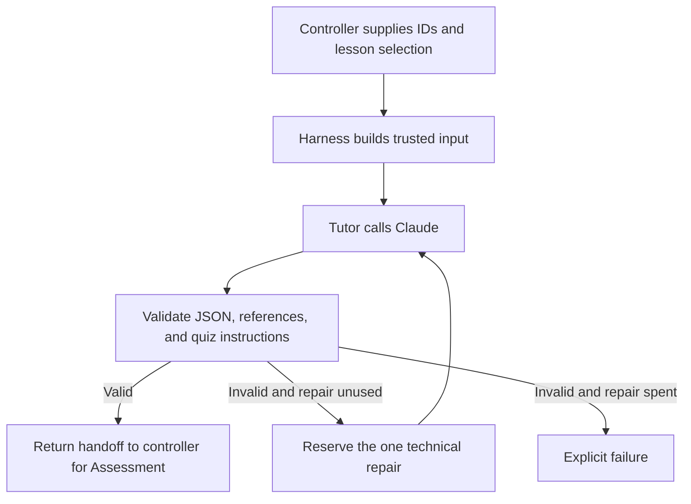

# Study Buddy Tutor (Agent 1)

The Tutor turns an approved lesson into a beginner-friendly explanation, or reteaches verified missed concepts. This module returns a validated handoff; the controller decides what happens next.

## Where this fits



## Parts to learn

| Part | Code | Responsibility |
| --- | --- | --- |
| Harness input | `tutor-input.mjs`, `lessons.mjs` | Load approved content, supply controller IDs, and separate instructions from lesson/feedback data. |
| Prompt | `prompts/tutor-system.md` | Explain or reteach using supplied source text and concept summaries. |
| Provider call | `claude.mjs` | Make one bounded request; reject transport failures and incomplete responses. |
| Agent loop | `tutor.mjs` | Generate, validate, and allow at most one technical repair. |
| Stopping conditions | `tutor.mjs`, `reteaching.mjs` | Reject invalid input before generation; stop on provider failure or exhausted repair; block ineligible reteaching. |
| Handoff checks | `tutor-output.mjs`, `handoff-policy.mjs` | Validate the schema, IDs, sources, concepts, retry focus, and unchanged 10-question/private-answer-key instructions. |
| Tests and evaluation | `*.test.mjs`, `evals/` | Offline regression tests plus separately invoked paid smoke evaluations and human review. |

## Calling the harness

Call `runTutor(context, claudeOptions, repairState)` from `tutor.mjs`. The controller supplies the lesson ID, session ID, handoff ID, and explanation ID. Retry input also requires a verified Assessment return handoff, the trusted current attempt, and the learning retry count.

Success returns `{handoff, model, usage, repairCount}`. `usage` adds reported top-level token counters across completed original and repair responses, including cache counters when supplied. It remains outside the handoff. A `TutorRunError` exposes the failing stage, repair count, and token usage accumulated before failure; unavailable provider usage cannot be estimated.

Technical repair and learning retry are separate. The repair state is consumed before the repair request, even if that request fails. There are at most two model calls in one run. Reteaching is eligible only after a first-round score below 8/10 with an unused learning retry and complete verified weak concepts.

## Run locally

From the repository root, using Node 22+:

```sh
pnpm --dir backend install
pnpm --dir backend test
node backend/evals/run.mjs
```

Offline tests use fake provider responses and do not need an API key. For an explicitly requested paid smoke evaluation, set `ANTHROPIC_API_KEY` in the ignored root `.env`, then run:

```sh
node --env-file=.env backend/evals/run.mjs --live
```

Never commit `.env` or API keys. See `evals/README.md` for scoring and limitations. Existing live results describe the prompt and code at their recorded run; they do not verify subsequent changes.

## Boundaries still belonging to the controller

This module does not grade quizzes, display screens, save sessions, reserve learning retries durably, or coordinate concurrent requests. The controller must persist and reserve repair/retry state to enforce limits across restarts and concurrent runs. Missing weak concepts are rejected here; their repair workflow belongs to the controller.

Structural validation cannot establish factual accuracy or detect every instruction hidden in otherwise valid explanation prose. Human review checks grounding and teaching quality. The handoff fixes instructions for Assessment, but Assessment must separately enforce its actual quiz size and keep its answer key private.

## Offline Tutor-to-Assessment integration test

From the repository root, install the Python validation dependency in a virtual environment and run the cross-language test:

```sh
python3 -m venv /tmp/study-buddy-tests
/tmp/study-buddy-tests/bin/python -m pip install -r requirements-dev.txt
/tmp/study-buddy-tests/bin/python -B -m unittest tests.test_tutor_assessment_integration -v
```

Node 22+ must be on PATH (or set `STUDY_BUDDY_NODE` to its executable); backend dependencies must already be installed. The test runs the real JavaScript Tutor harness with a fake Claude response, passes a fixture quiz with matching IDs through the Python Assessment validator, and saves it to an in-memory database. It checks ten learner-facing questions, private keys, foreign-key integrity, and rejection of stale IDs, wrong rounds, wrong quiz size, and untaught concepts. The return-handoff tests use the real Python grader to compute a 6/10 score and weak concepts, then check that the JavaScript Tutor input builder accepts only those concepts. They also cover the 7/10 and 8/10 boundary, missing weak concepts, and a spent learning retry. The return envelope is assembled by the test as a stand-in for the future controller. These tests make no API calls and do not test AI quiz generation, factual quality, durable retry reservation, or a complete second quiz/session.


## Controller: first routing step

`study_buddy/controller.py` exposes `start_session(conn, learner_id, lesson_id)`. Use a SQLite connection initialized with `db/schema.sql`, load approved lesson files with `study_buddy.lessons.load_lessons`, and register the learner first. The caller must supply the learner ID from trusted application context; authentication is still separate work.

The controller selects the approved lesson version from the database, generates session/handoff/explanation IDs, and commits a teaching session before calling Tutor. `backend/tutor-command.mjs` bridges Python to the existing JavaScript harness using JSON on stdin/stdout. Node must be on PATH or configured by `STUDY_BUDDY_NODE`. A real successful call uses the Claude key in the process environment: load the root `.env` into the backend environment before live use. Never put a key in the input JSON or source code.

The existing Tutor harness owns its one-repair loop. The controller independently checks the returned schema, session IDs, lesson version, sources, and taught concepts before saving the explanation and its concept links in a transaction. It returns `next_step: assessment` on success, but does not dispatch Assessment yet. Session status stays `teaching` because no quiz is ready. It never marks the session completed.

On Tutor/validation failure it records `failed` and returns no handoff or next step. A failed explanation save rolls back its partial records and records failure; if recording failure also fails, the database error propagates instead of claiming success. No score, quiz, or learning retry is created by this step.

Run the seven new offline controller tests from the repository root (Python validation dependencies and backend packages installed, Node available):

```sh
python -B -m unittest tests.test_controller -v
```

Six tests inject a fixture Tutor runner; one exercises the real Node adapter with invalid context that stops before generation. They make no paid API calls. Full successful provider transport is covered separately by the Tutor harness tests/live evaluations. Durable repair reservation while the Node process is running, crash recovery, request idempotency, the live Assessment adapter, and atomic learning-retry reservation remain later controller steps; saving the returned repair count does not enforce limits across a process crash.


## Controller: Assessment boundary and quiz storage

`start_quiz_session(conn, learner_id, lesson_id, assessment=runner)` runs the first Tutor step, then calls `runner(handoff, repair_request=None)` once on the happy path. The runner receives a copy of the validated Tutor handoff and returns the private quiz-output object defined in `schemas/v1/quiz_output.schema.json`. There is no default AI Assessment runner yet; tests inject fixture output.

The controller checks the quiz with Soma's validator: exactly ten questions, matching handoff/explanation IDs and round, taught concepts only, distinct options, and a matching private key. Invalid output can use the remaining technical repair for the same handoff: the count is reserved in SQLite before correction and cannot reset after Tutor already spent it. The runner must make one generation per invocation and must not add its own hidden repair loop. Provider exceptions fail explicitly. The controller does not pass raw invalid model output into the correction instruction.

Saving the quiz, its questions, its separate answer keys, and `awaiting_answers` happens in one transaction. `save_quiz(..., manage_transaction=False)` participates in this caller-owned transaction; existing callers retain its default standalone transaction. Failed saves roll back all quiz records and mark the session failed, while preserving its already saved explanation. A failed failure-status save still propagates rather than claiming success.

Success returns only `{session_id, status, next_step, quiz, error}`; `quiz` comes from `get_client_quiz`, so no answer keys or rationales are sent to the learner. No answer submission, score, or learning retry is created here. The controller suite now has fourteen offline tests, including rejection of mutated input copies and exhausted repair budgets. The real AI Assessment adapter, learner-facing API/authentication, idempotent dispatch, and crash recovery remain separate work.


## Controller: answer submission and deterministic grading

`submit_answers(conn, learner_id, quiz_id, answers)` accepts a complete mapping of stored question IDs to options `a`–`d`. It first checks quiz ownership and that the session is awaiting answers. Missing, extra, or invalid answers raise `SubmissionRejected` and create no attempt or score. A missing/incomplete saved key is a technical failure, never a wrong learner answer.

The controller reads the backend key, calls Soma's deterministic `grade` function, and conditionally claims the session for grading. The claim and all attempt/response/result/weak-concept writes share one SQLite transaction. A savepoint rolls back partial submission records on a save error while retaining the write lock long enough to record the failed session. If that failure record cannot be saved, the database error propagates. A repeated or concurrent submission cannot claim the same awaiting session twice; this currently rejects duplicates rather than returning an idempotent cached response.

After a successful save, the response includes the verified score, pass/fail, per-answer key-based rationales, weak concepts, and stored attempt/result IDs. Correct options appear only after a complete authorized submission has been saved. The stored `results.feedback` is currently JSON containing deterministic graded items, not Assessment-written prose.

The session stays `grading` with `next_step: assessment_feedback`. It does not call an AI feedback agent, reserve a learning retry, or mark completion in this step. Next work is to validate Assessment's feedback against these stored results and route onward. P1 confidence/diagnostic extensions are not implemented here.

Seven additional offline tests cover the 8/10 boundary and weak concepts, bad input, learner isolation, duplicate and simultaneous submissions, missing keys, and transaction rollback. The controller suite now has 21 tests. The concurrent test uses two SQLite connections to a temporary database and verifies exactly one saved attempt and result.


## Controller: validated Assessment result feedback

`explain_results(conn, learner_id, attempt_id, assessment=runner)` is exported from the controller; its implementation lives in `study_buddy/feedback.py`. The callback signature is `runner(context, repair_request=None)` and returns the strict `result_explanation` v1 object. This is an injected adapter boundary; a live AI Assessment feedback runner is not implemented yet.

The controller authorizes the learner/attempt, checks the latest attempt and grading status, and reconstructs verified grading from stored responses and the private key. It checks the stored score and weak-concept evidence for consistency. The callback receives that verified result, the taught explanation, source metadata, IDs, and output schema. It receives a copy so it cannot mutate trusted controller evidence.

A unique `feedback_operations` row claims the attempt before generation and records its `assessment_to_tutor` handoff ID. Repeated calls return running/ready/failed operation state rather than starting a fresh repair budget. Invalid output receives at most one repair, reserved in `handoff_repairs` before the correction call. Provider failure stops explicitly. A running operation after a crash requires reconciliation; it is not automatically restarted.

Validation checks the schema, exact quiz/attempt IDs, ten nonempty feedback entries, unique weak concepts, and the controller's exact missed counts. The controller saves the feedback object in `results.feedback` without changing the verified score, pass/fail, responses, or weak-concept evidence. It also returns the authoritative score/pass separately. Structural checks cannot prove that every prose sentence or summary is factually correct; content evaluation remains necessary.

Success leaves session status `grading` and returns `next_step: retry_decision`. It neither dispatches Tutor reteaching nor marks completion. Feedback/save failure marks the operation and session failed while preserving the saved grading. If the failure record itself cannot be written, the database error propagates.

For a new database, the table is included in `db/schema.sql`. For an existing database created before this step, apply `db/migrations/001_feedback_operations.sql` once before calling feedback routing. The migration is additive; there is no automated migration runner yet.

Run the nine offline feedback tests with:

```sh
python -B -m unittest tests.test_feedback -v
```

They use fixture callbacks and actual saved controller attempts to cover validation, one repair, operation reuse, wrong-learner access, preserved scores, failed writes, and the additive migration. They do not verify live AI content or crash recovery.


## Controller: retry decision and reservation

`decide_next_step(conn, learner_id, attempt_id)` verifies learner ownership, the current attempt, stored grading, and saved/validated Assessment feedback. In one SQLite write transaction it either reserves the first low-score learning retry or records the summary route. `session_routes` persists one decision per attempt and has a unique index allowing only one reteaching route per session.

For a first-round score below 8/10 with retry count 0, it atomically sets count 1 and status `reteaching`, stores a schema-valid Assessment-to-Tutor return handoff, the verified source attempt, and new Tutor handoff/explanation IDs. The prepared context excludes answer keys and reports the actual reserved count of 1. The new outgoing Tutor handoff has its own technical repair record; this does not reset the incoming feedback handoff's repair count. Repeated or simultaneous decisions return the same reservation rather than consuming another retry. Old attempts, failed sessions, wrong learners, and missing/inconsistent feedback are rejected.

At 8/10 or above, after the retry round regardless of score, or when no learning retry remains, the route is `summary` and status becomes `pending_save`. This step does not save the final summary or mark the session completed. A failed route save rolls back the counter, route, new IDs, and status together; the DB exception propagates so no reservation is falsely reported.

Reservation itself does not dispatch Tutor. The separate dispatch_reteaching step verifies and claims the stored reservation before invoking Tutor with the actual consumed count of 1. The JavaScript input guard now accepts that trusted, matching reservation context; it still rejects a consumed count without a valid claimed reservation. It does not receive a fabricated zero count.

New databases include the table/index in `db/schema.sql`. Existing databases must apply `db/migrations/002_session_routes.sql` once after migration 001. No automated migration runner is provided yet. Run the nine offline routing tests with:

```sh
python -B -m unittest tests.test_routing -v
```

They cover 6/10 and the 7/10–8/10 boundary, retry-round termination, feedback/learner checks, repeated and simultaneous reservation, stale attempts, failed-session protection, and save rollback. The retry-round case tests the decision boundary with stored state, not a complete live second-quiz session.


## Controller: dispatch the reserved Tutor retry

`dispatch_reteaching(conn, learner_id, source_attempt_id, tutor=runner)` claims the saved retry route in a short SQLite transaction before calling Tutor. It verifies ownership, active session/retry state, current attempt and grading, the approved lesson version, saved feedback, and the fresh outgoing handoff's technical repair state. It uses stored route data rather than caller-supplied model context.

The backend-only Tutor context includes `learningRetryCount: 1` plus `retryReservation` bound to the session, source attempt, outgoing handoff ID, explanation ID, and dispatched state. `buildTutorInput` accepts these trusted controller fields after the DB claim; it does not put the reservation object into the model prompt. These fields are not cryptographic proof and must never be accepted directly from a learner-facing request. Existing standalone unused-retry input remains supported for offline evaluations.

Only one caller changes the route from `reserved` to `dispatched`. A second caller sees running state or the saved output, without invoking Tutor again. A process crash after dispatch leaves running state requiring reconciliation; it does not automatically restart with a refreshed budget. The Tutor's internal one-repair loop remains bounded, and its reported consumed count is recorded on return.

The returned explanation must match the retry IDs, sources, approved version, and exactly the verified focus concepts. Explanation text, concept links, full validated handoff (inside route context), and outgoing repair count are saved in one transaction. No quiz is created here. Successful status stays `reteaching`, with the handoff ready for Assessment. Validation or save failure marks the route/session failed and retains learning retry count 1. Failed operations are returned without regeneration.

Run the ten offline dispatch tests with:

```sh
python -B -m unittest tests.test_reteaching -v
```

They cover correct reservation context, a real cross-language input-guard check without generation, duplicate and simultaneous dispatch, scope/owner checks, immutable controller context, exhausted technical repair, and save rollback. Assessment retry-quiz dispatch and final summary remain later steps. No paid model calls are made by these tests.


## Controller: focused 10-question retry quiz

`dispatch_retry_quiz(conn, learner_id, source_attempt_id, assessment=runner)` claims a unique `retry_quiz_operations` row for the session/source attempt before calling the Assessment callback. It requires the saved Tutor retry handoff to match the approved lesson, focused explanation text, and stored taught concepts. Callback signature and private quiz-output schema are the same as first-round quiz generation. A live AI Assessment adapter is still not provided.

The quiz validator enforces round `retry`, matching handoff/explanation IDs, exactly ten questions, four distinct options, only the taught focus concepts, and matching private keys. Invalid output can use only the remaining repair of the Tutor-to-Assessment handoff; a repair already consumed by Tutor cannot be refreshed. Duplicate requests return running state, a saved safe quiz, or the failed operation without new generation.

The retry quiz, questions, private keys, ready operation, and `awaiting_answers` status are saved together. A failed save rolls back partial quiz records, marks failure, and preserves the first attempt and consumed learning retry. The learner response comes only from `get_client_quiz`. This step never changes the learning retry counter or creates a third quiz.

The existing submission and feedback routes handle the retry's answers. After the retry feedback is saved, `decide_next_step` moves to `pending_save`/summary regardless of score. A replay of the original quiz cannot create another first-round attempt while the retry is awaiting answers. Summary persistence and marking completion remain a later step.

New databases include the operation table in `db/schema.sql`. Existing databases apply `db/migrations/003_retry_quiz_operations.sql` once after migrations 001 and 002. Run the nine offline tests with:

```sh
python -B -m unittest tests.test_retry_quiz -v
```

These tests use fixture callbacks and verify focused/private quiz persistence, operation reuse, exhausted repairs, isolation, rollback, an additive migration, stale original-quiz submission, and the real controller path through retry grading and feedback to the summary decision. Focused fixture questions repeat for test construction; these tests do not evaluate question novelty, factual quality, or live AI quiz generation.


## Controller: save the final summary

`finish_session(conn, learner_id, session_id)` completes a session only after its final summary is saved. It requires the learner's `pending_save` session, a pending summary route, and complete attempts with validated feedback. It checks scores and missed concepts again against the saved answers and private keys. The summary contains source attribution, attempt scores, and concepts to revisit; it excludes private keys and makes no claim of long-term mastery. No model call is needed.

Summary insertion, completion status, and route completion share one transaction. A failed write rolls back partial completion, preserves graded progress, and leaves status `pending_save` with an error so saving can be retried. Repeated or simultaneous successful calls return the same stored summary. This completes the persistence step described as pending in the earlier sections.

New databases include `session_summaries` in `db/schema.sql`. Existing databases apply `db/migrations/004_session_summaries.sql` once after migrations 001–003. Run the nine offline summary tests with:

```sh
python -B -m unittest tests.test_summary -v
```

They cover save-before-completion, repeated and simultaneous requests, failed writes and recovery, learner isolation, altered scores, the additive migration, and the full fixture-based controller path through a focused retry to completion. Live Assessment generation, a learner-facing API, authentication, and crash reconciliation remain separate work.


## Assessment: quiz prompt (not wired yet)

`backend/prompts/assessment-quiz-system.md` defines quiz-generation behavior against the existing `schemas/v1/quiz_output.schema.json` contract and Soma's `scripts/validate_quiz.py` validator. It limits questions to Tutor's explanation, copies controller IDs, creates ten four-option questions, and keeps keys in the private output section. Retry quizzes stay within the supplied focus concepts.

This is only the instruction file. No Assessment input builder or provider adapter loads it yet, and no model calls or quality evaluations were run for this prompt. A future adapter must intercept the local failure object; the existing controller treats nonconforming output as invalid and owns the remaining repair budget. Next step: build the input harness with separate instructions and handoff data.


## Assessment: input harness

`buildAssessmentInput(handoff)` in `backend/assessment-input.mjs` returns separate `{system, user}` strings without calling a model. It checks the v1 handoff, fixed quiz policy, nonempty content, unique concepts, source/lesson consistency, and exact taught focus on retries. It packages IDs, explanation, sources, concepts, and the existing quiz-output schema as JSON data. Agent-authored uncertainty and output-instruction text are not forwarded as instructions.

The caller must first validate ownership, controller IDs, approved sources, and retry eligibility against trusted controller records. This helper cannot authenticate a caller or prove the explanation is factually correct. Instruction separation does not guarantee model resistance to injection. The prompt is now loaded by this harness; provider dispatch remains the next step. Five offline tests cover first/retry input, malformed handoffs, scope/policy changes, injected fields, instruction separation, and mutation isolation.


## Assessment: single-call provider adapter

`runAssessmentQuiz(handoff, {repairRequest, claudeOptions})` in `backend/assessment.mjs` uses the input harness and shared Claude transport for exactly one generation. Keys stay in the environment; tests inject fake transport. It returns `{output, model, usage}` to backend code. Output is parsed but remains unvalidated and may contain private answer keys: never return it directly to a learner. Malformed JSON becomes `output: null`; local failure objects and other invalid objects go unchanged to controller validation. No output is saved here.

A nonempty, trusted controller `repairRequest` selects a fixed correction instruction, preserving the original handoff and excluding raw invalid model text. It does not reserve a repair or authorize another call itself. Transport/input failure throws a safe `AssessmentRunError`; it makes no automatic retry. The controller must reserve its persisted budget before invoking a repair. The Python callback bridge is not wired yet; that bridge must unwrap `output` for the existing quiz validator and use the existing controller flow. Six offline adapter tests use fake responses; live generation, content quality, and resistance to prompt injection are not established by them.


## Assessment: Python controller bridge

`study_buddy.assessment.run_assessment(handoff, repair_request=None)` invokes `backend/assessment-command.mjs` with JSON on stdin and unwraps its private `output` for the existing Python quiz validator. The Node subprocess has a 40-second timeout around the shared 30-second provider timeout. Only safe error stages cross back to Python; credentials stay in the process environment. Node must be available through PATH or `STUDY_BUDDY_NODE`, with backend packages installed.

`start_quiz_session` and `dispatch_retry_quiz` now default to this real provider bridge, while still accepting injected callbacks. Calling them without an Assessment callback can spend API credits when valid input and credentials are present. The controller alone validates output, reserves the remaining technical repair, and saves quizzes/private keys atomically. This supersedes earlier notes that quiz generation has no default adapter. Assessment result-explanation generation still requires an injected callback and is not implemented by this quiz adapter.

Six bridge tests exercise real Python/Node input packaging, fake provider transport, safe quiz persistence, one reserved repair, explicit failure after exhausted repairs, provider errors, bad input, and broken/timeout process responses. Run `python -B -m unittest tests.test_assessment_bridge -v`. These tests inject a fake fetch through a temporary Node preload; production code has no fixture-response switch. They do not establish live quiz quality. Model/usage metadata is returned by JavaScript but not persisted by this Python bridge yet.


## Safe Assessment failure diagnostics

Claude transport errors now use `ClaudeCallError` with a fixed code. The Assessment adapter and stdin/stdout bridge preserve that code, an integer HTTP status where available, and an allowlisted stop reason. Python exposes `AssessmentFailure.code`, `.http_status`, and `.stop_reason`. The evaluation runners save these fields. Learner-facing controller messages remain generic; these diagnostics are not yet stored in session records. No provider error bodies, raw exception messages, credentials, headers, or private reasoning are added to diagnostics.

| Code | Meaning |
| --- | --- |
| `missing_api_key` | No configured Claude key; no request made |
| `authentication_failed` | HTTP 401 or 403 |
| `rate_limited` | HTTP 429 |
| `provider_unavailable` | Provider HTTP 5xx |
| `api_rejected` | Other non-success HTTP response; status is preserved |
| `output_truncated` | Provider stopped at `max_tokens` |
| `incomplete_response` | Another non-end-turn stop; unknown reasons become `unknown` |
| `request_timeout` | Shared Claude request timeout fired |
| `transport_error` | Network/read failure; precise underlying cause is intentionally omitted |
| `unexpected_response`, `empty_response` | Unusable provider content |
| `process_timeout` | Python's Node subprocess deadline fired |
| `process_unavailable`, `invalid_envelope` | Node launch failed or command output could not be read |

Input/configuration errors use `invalid_input` or `invalid_timeout`; otherwise unexpected adapter failures use `adapter_error`. Codes do not grant retries or change budgets. The earlier live controller failure cannot be retrospectively classified; another explicitly authorized live run is needed to observe its current outcome.
