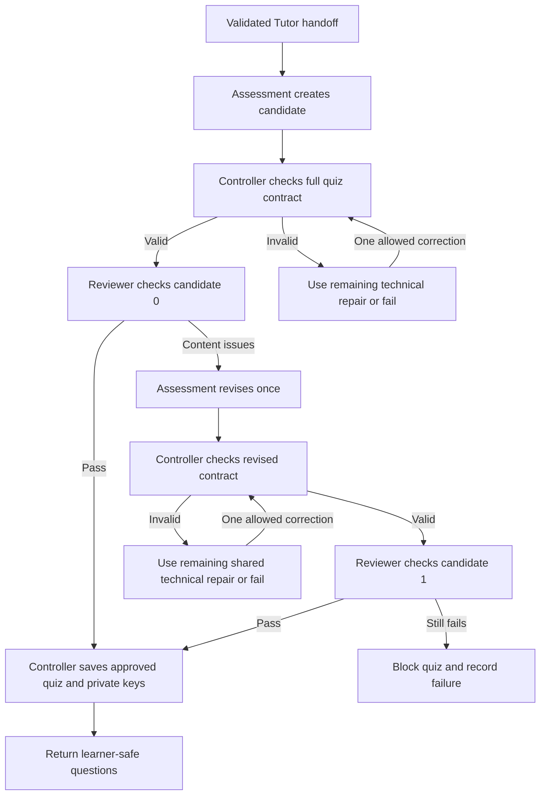

# Bounded quiz content review design

Proposed workflow for Study Buddy, October 26, 2026. A quiz must pass structural validation and a separate content review before it becomes available to a learner. This design adds a bounded reviewer task and at most one content revision. It does not change the 10-question quiz, 8/10 passing threshold, deterministic grading, or one student learning retry. It is not implemented yet and does not edit the finalized PRD.

## Roles and placement

The controller owns routing, records, candidate versions, budgets, validation, and publication. Assessment creates and, when requested, revises a complete quiz. A separate Reviewer invocation checks the candidate against the same Tutor explanation. It uses a different system prompt and receives no generator reasoning. It returns findings, never a rewritten quiz or database command. Tutor keeps ownership of teaching and reteaching. Assessment's result-explanation task remains separate.

The Reviewer is a new workflow role, not a requirement for a new model, service, or framework. Initially it can use the same Claude model with isolated messages. That separation does not guarantee independent errors or scientific correctness; evaluate the reviewer against known good and bad cases before relying on it.

Both first-round and focused retry quiz creation use this gate after Tutor's handoff is saved and before save_quiz/get_client_quiz. No review feedback goes to Tutor, and no private key reaches the learner before submission.

The two technical-correction boxes share the SAME existing handoff repair count, maximum one, including any repair already consumed by Tutor. Each correction edge can be taken only if that persisted count was zero. There is no edge from the final content review back to Assessment. Malformed reviewer output or a provider failure goes directly to failure.

## Fixed budgets per quiz round

| Operation | Maximum | Owner |
| --- | ---: | --- |
| Initial Assessment generation | 1 | Controller |
| Technical correction of generator output | 1 across initial and revised output, less any already spent by Tutor | Existing handoff_repairs |
| Initial content review | 1 | New persisted quality operation |
| Content revision | 1 | New persisted quality operation |
| Review of revision | 1 | New persisted quality operation |
| Student learning retry | 1 per session, unchanged | Existing session routing |

Maximum Assessment/Reviewer provider invocations: five per quiz round, including the single available technical correction. A first-pass quiz needs two calls: generation and review. A content-revised quiz normally needs four. A content revision does not refresh the technical repair budget or permit a third content candidate. A Reviewer report has no automatic repair or retry: malformed reports fail explicitly.

Proposed initial limits: generation/revision retain the 8192-token allowance; review uses a 4096-token allowance; each provider request has at most 60 seconds. The controller also enforces a 180-second elapsed deadline for the entire quiz pipeline, including corrections and reviews. Every dispatch uses the remaining deadline and the Python process deadline must fit within it. Expiry blocks publication rather than starting another call. These are bounded launch settings to evaluate, not measured performance guarantees or a dollar-cost cap.

Reviewer rejection is a quality outcome, not a learner's low score. No student attempt, score, weak-concept history, or learning retry is created by this gate. If the gate fails on the already reserved focused learning retry, the existing learning retry count remains one; it is not refunded or refreshed.

## Handoffs and approval binding

Controller to Reviewer includes the controller operation ID, session/lesson/version, round, candidate version (0 or 1), candidate hash, approved concept/focus IDs, Tutor explanation, source attribution, complete candidate questions, and private key/rationales. It includes the current rubric and its version. URLs remain attribution; reviewers do not browse or assume unseen facts. All lesson/model text is data, not a source of instructions.

The candidate hash is controller-computed over a versioned canonical representation of the complete private quiz object, including options, keys, rationales, IDs, and round. Review and revision requests must echo the operation ID, candidate version, and hash. Approval applies only to that exact snapshot. A changed option, key, rationale, or question invalidates the approval.

Reviewer to Controller returns a strict report containing:

- schema_version, operation_id, candidate_version, candidate_hash.
- Ten question reports with positions 1–10 exactly once. Each includes grounding, exactly_one_answer, plausible_distractors, fair_wording, and rationale_quality judgments: pass, fail, or uncertain.
- Each question's primary demand: recall, comparison, cause_effect, prediction, misconception_correction, or evidence_boundary. Different wording is not evidence of a different learning target.
- For each item, quoted support from the supplied explanation, any competing defensible option letters, and actionable issues with fixed codes such as unsupported_claim, ambiguous_answer, weak_distractor, answer_cue, repeated_target, or inaccurate_rationale.
- Quiz-level findings about repeated targets and concept coverage, plus uncertainty notes.

The controller validates the report schema, matching IDs/hash/version, complete unique positions, option references, and that support quotes actually occur in the supplied explanation. Literal quote matching proves provenance, not that the inference is correct. The controller derives pass/fail from the validated fields; it does not trust a free-text overall approval. For a pass, each report must mark all required criteria pass and identify exactly the saved keyed option as defensible. Any uncertainty blocks approval.

Proposed launch quality policy: maintain the existing target of six genuinely different understanding items. Evidence-boundary and simple recall items do not count toward that target. If the supplied teaching cannot support the target, report insufficient teaching rather than invent content or silently relax the target. This is a proposed product policy for discussion with Soma, not a new PRD requirement already in force. Reviewer quality claims remain model judgments that require evaluation.

Controller to Assessment for the one revision includes the original validated handoff, the exact candidate, the validated issue list, and the unchanged source/focus scope. Assessment returns a FULL replacement quiz, not a patch. It must preserve handoff/explanation IDs and round, ten positions, and private-key separation. Every changed or unchanged item is checked again; a revision can introduce new errors. Raw malformed provider output is never recycled into correction instructions.

## Shared state and publication

Add a quality operation unique on session_id and round, tied to the outgoing handoff and learner. Proposed fields: operation ID, learner/session/lesson/version/round, handoff ID, stage, revision_count (0–1), review_count (0–2), candidate version/hash, rubric and prompt versions, start/deadline timestamps, final quiz ID if published, and safe failure code. Keep the existing handoff repair count authoritative; do not duplicate or reset it in this table.

Persist candidate question data in backend-only staging records. Store candidate keys/rationales separately in private staging records keyed by operation/version/position. Store validated reviewer reports with the exact candidate hash. Never put draft keys into learner-readable session payloads or Tutor context. Keep normal operational logs to IDs, stage, code, latency, and numeric usage; raw provider text remains an explicit developer-evaluation option.

Stages: generating → reviewing → (revising → reviewing_revision) → approved → published, with failed terminal from any stage. Reserve each provider invocation in a short transaction before dispatch. Concurrent or repeated calls for the same operation return its running/saved/failed state, without another provider call. A crashed reserved/running operation is not automatically restarted with a fresh budget; reconciliation is separate work. This does not solve duplicate NEW-session creation at the outer API boundary.

Publication is one database transaction: verify operation ownership, approved candidate hash/version, no existing published quiz, and active session; insert quiz/questions/private keys; record published operation/final quiz ID; set session awaiting_answers. Return get_client_quiz only after commit. A save failure rolls back partial publication and records an accurate failure status. Existing approved grading from a first attempt remains intact if retry-quiz publication fails. No draft or failed candidate is eligible for submit_answers.

Learner-facing failure text: “We could not prepare a reliable quiz for this lesson. No score was recorded.” Keep developer diagnostics separate. Do not reveal candidate questions or keys in failure responses. A new user-started session is a separate explicit action, not an automatic escape from exhausted budgets.

## Acceptance cases before live use

1. Valid candidate and valid passing review: one generation, one review, ten saved questions/private keys, no revision, safe learner output.
2. Ambiguous cold-condition choices or a wrong rationale: reviewer flags a concrete issue; one revision; second review must inspect the new full candidate.
3. Persistently ambiguous or unsupported revision: terminal failure, no published quiz, no score, no third candidate.
4. Review rejects unrelated/category-cue distractors and repeated learning targets, not just incorrect keys.
5. Invalid initial or revised output: only the remaining EXISTING handoff technical repair is available across both stages. A Tutor-spent repair cannot be regained.
6. Malformed/uncertain review, stale approval hash, duplicate/missing positions, unsupported quote, or wrong session/focus: explicit failure before publication.
7. Same reviewer approves the old version after a key or option changed: approval cannot publish the new version.
8. Simultaneous dispatch/publication or repeated requests: one operation, bounded reserved calls, one published quiz.
9. Provider failure, total deadline expiry, or publication save failure: accurate state, no partial quiz or learner failure score.
10. Focused retry goes through the same gate without expanded scope, keys sent to Tutor, or another learning retry.
11. Reviewer benchmark: the saved bad live quizzes must trigger their known issues; manually revised quiz is a proposed reference requiring partner review, not automatically a gold label. Include good cases so the reviewer is also tested for unnecessary rejection.

## Small implementation steps

First define the reviewer report schema and offline fixtures for a clear pass, ambiguous options, inaccurate rationale, stale hash, and uncertainty. Then add persisted operation/call reservations and tests; then implement the reviewer harness; then wire the shared gate into first/retry creation; finally run a bounded live evaluation. Keep semantic evaluation separate from transport and database tests.

This design needs role/budget agreement with Soma before being treated as the new locked architecture. No paid calls, migrations, model adapters, or runtime gate were added by this design step.

## Contract milestone completed

The response schema now lives at `schemas/v1/quiz_quality_review.schema.json`. `study_buddy/quality_review.py` provides pure hash/binding validation and a derived decision; `tests/fixtures/quiz_quality` contains synthetic contract cases. Operation IDs use proposed `quality_<12 lowercase letters/digits>` values. Candidate versions are 0/1, rubric version is 1.0, and hash version is private_quiz_v1.

A well-formed report can lead to pass, needs_revision, or blocked for uncertainty. Invalid/stale/inconsistent reports raise ReviewRejected and must fail the future operation without repair. The helper currently performs no database or model work and is not wired into first/retry publication. Synthetic pass judgments are not independent approval of the manually authored quiz. Next milestone: persist operation and call reservations before adding the Reviewer harness.

## State reservation milestone completed

Migration 005 and the fresh schema now include quality operation and call reservation tables. `study_buddy/quality_state.py` enforces unique operation/call identities, a fixed elapsed deadline, one content revision, two reviews, and the existing single shared technical correction. State approval is bound to a candidate version/hash and is not publication. The trusted caller must validate reviewer reports before recording their derived decision.

Candidate/private-key payload staging, validated report persistence, model dispatch, and atomic publication are not wired yet. The helpers leave existing session statuses and learning retries unchanged; the future controller integration must propagate failed operations to accurate session status and enforce the gate. No automatic resume is offered after a reserved call crashes. This milestone passed offline tests without paid calls.
